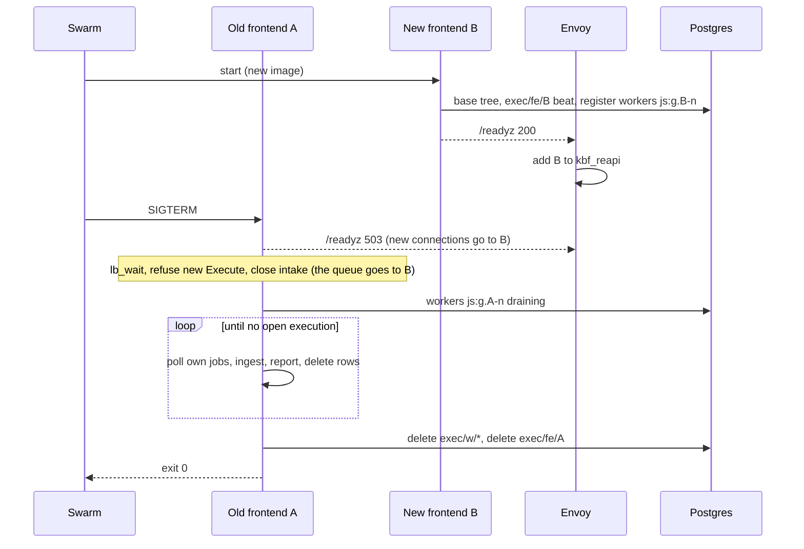

# N frontends: a leaderless executor

> **Status: kbf-daemon is deleted.** Where this page describes the daemon, the `daemon`, `storage-and-daemon` or `all-in-one` modes or a Mac daemon, it records the design as it was written. Placed actions now run only as js-agent jobs of the job service, storage nodes run `kbf --mode=storage`, and Macs run js-agent only ([kbf-modes.md](../deploy/kbf-modes.md#the-removed-modes)).

Status: **DESIGN, partly built.** Built: the row API and its model search (PR 3) and shared ownership part 1 (PR 4:
`--executor-ownership shared`, `--executor-live-secs`, the rows written and deleted, no rival check and no cancel at start, at a
fence or at the end). Not built: adoption (PR 5) and what follows it. A living document: it is changed in the pull request that
changes the thing it describes.

Read against kbf `main` at `8408618` (the executor is `crates/kbf-server/src/executor/`), komira-internal `main` at `1d2fdbd`
(`controlplane/swarm/kbf-frontend.yml`, `controlplane/envoy/`, `docs/design/controlplane-swarm.md`), and tierstore `main` at
`b8ae6457` (`packaging/README.md`). komira-internal pull request #1746 (docs only, open) is the earlier investigation; this
document keeps its findings and replaces its recommendation (an executor lease), which the owner rejected.

Marks used in the text, so a reader can tell what was done from what was reasoned:

- **[F]** read in the code or the document named, at the revision above; not run.
- **[M]** produced by running the protocol model of section 8 (`python3 -I adopt_model.py`, source in appendix A).
- **[I]** inferred, with the reason; not measured.
- **[N]** not measured; section 7 names the pull request that measures it.

## 1. Decisions this document rests on (owner, 2026-11-15)

1. The kbf frontend, js-server and coordinator run **one instance in steady state and two during an update** (`replicas: 1`,
   start-first). Code is correct for any N on one shared Postgres: the same rules hold at 1, 2 and 3 (a second update begins while
   a first frontend still drains).
2. **No leader, no lease, no election, anywhere.** Postgres is the single source of truth. Every decision is a transaction that is
   correct whichever instance runs it and however many run it at once: row locks, claims, compare-and-set on version columns,
   per-row claims for periodic work. The database is the accepted central dependency: no decisions while it is unreachable.

Rule 2 is read strictly. A row that says "this frontend is alive until T" (section 4.2) is **not** a lease on a role: it holds no
exclusive right, it only tells the others that jobs it submitted are still being read, and nothing that must happen once
depends on it (section 5). It is the same shape as the `session/` row the farm already writes for a daemon.

## 2. The problem

Under `--executor js-agent` a placed action is one job of the job service. Everything the executor knows about its jobs is in the
memory of one process. The frontend's own drain (`sequence.rs`) already lets two frontends share a farm (section 3); the executor
is what still assumes it is alone. Each row below is a behaviour of the code today [F] and what it does under start-first.

| Where | What it does | Under start-first |
|---|---|---|
| `executor/mod.rs` `Executor::rival`, `driver.rs` `drive` | Every `adopt_watch` it lists the live jobs of the job service; a job labelled with another frontend id whose oldest live job is older makes this frontend stop (`Running::failed`, then `ServeError::Executor`, exit). | The new frontend finds the old one's jobs and **exits**; Swarm rolls the update back. |
| `executor/pool.rs` `adopt_jobs` | At start, before the first submit, every live job labelled with this frontend id and another process's instance is **cancelled** (after one `adopt_watch` to see whether that process is alive: if it made a new job, this process stops with `Twin`). | The slot's id is the same for the old and the new task (`executor-frontend-id = kbf-fe-slot-1`), so the new task either stops as a twin or cancels what the draining one is running. |
| `executor/mod.rs` `Executor::shutdown`, `host.rs` `HostWorker::retire`, `runs.rs` `cancel_all` | The end of the executor cancels every job it holds. | A frontend that is killed (second SIGTERM, `--shutdown-timeout-secs`, `stop_grace_period`) cancels work that finished builds could still have used; a crash cancels nothing and leaves the jobs with no reader. |
| `host.rs` `fence` | A worker silent from the farm or the job service for `fence_after` (40 s) cancels its jobs and falls silent for `LEASE_GRACE`. | In a pair, the survivor may have adopted those jobs by then (section 5.5): the cancel would kill the adopter's job. |
| `host.rs` `register`, `config.rs` | Worker ids are `js:<frontend id>-<n>`; one id per slot. | Two live processes registering one worker id take its `owner/` row from each other. |
| `runs.rs` `Task` | `Waiting`, `Running`, `Withdrawing`, `Ingesting`, `Reporting` live only in the worker's `BTreeMap`. | A process that ends loses them: the farm requeues the lease (after the handover grace) and runs the action again, and the old job runs on unread until the job service's wall limit. |

Four things beside the executor, found while reading for this document, would also break a second frontend. They are not the
executor's, but N frontends need them (section 6):

- The history is `file://`, locked by `flock` for the life of the process (`kbf-objstore/src/fs_store.rs`); the new task cannot open
  the slot's history directory until the old one exits (`history/lock_wait.rs` retries the open). `--history-objects=s3://…`
  took its key pair only from the process environment (`history/flags.rs` `process_env`), and a Swarm secret is a file; PR 2
  added `--history-credentials-file`.
- The base-tree cache directory `/var/lib/kbf-frontend/base-tree` is shared by the two tasks and its fetch is not safe for two
  processes (`frontend/base_fetch.rs`, section 6.3).
- The learned-size rows (`est/`) are written with `Cond::Any` from each process's memory (`farm/durable/ext.rs` `put_estimates`),
  so two frontends overwrite each other's samples (section 6.5).
- Per-slot configuration (`--executor-frontend-id`, `pack-writer = kbf-fe-slot-1`, `slot-{{.Task.Slot}}` binds) exists only because
  of the one-frontend rule.

## 3. What is already N-ready

These need no change; the new design stands on them. Test names are the ones to read.

- **The farm over one store.** Frontends over Postgres take no writer generation (`kbf_state::share`, marker `shared-writers`);
  each scheduler write is conditional on the rows it read; each frontend takes up what the store shows it
  (`docs/design/scheduler.md`, "Frontends that share work") [F].
- **A node moves between frontends.** `owner/<node>` holds a frontend id and a counter; a `Hello` takes it with one compare-and-set;
  every lease write of the node carries a check of that row, so the loser's write fails "stale owner". The new owner takes up the
  unfinished operations whose lease rows name the node, and the first heartbeat lists what it runs: a listed lease is kept, an
  unlisted one is given up after `HANDOVER_GRACE` (45 s) and `OWNER_CACHE_TTL` (2 s) [F]. Test:
  `a_daemon_that_moves_to_another_frontend_keeps_its_lease` (`crates/kbf-server/tests/state_store/owner.rs`). The executor's
  virtual workers register through the same `enroll` as a daemon (`farm/linux_daemons.rs` `register_virtual`), so **this is the
  hand-over the adoption of section 4 uses**; the scheduler's own text calls re-adopting work across a restart "planned"
  (`scheduler.md`, "Reconciling with what workers say they run") [F].
- **A lease nobody serves is requeued.** The orphan sweep requeues a lease whose node has no `session/` row anywhere, `ORPHAN_WAIT`
  (25 s) after it saw that; the session row lives `LEASE_GRACE` (60 s) from its last write, so the earliest requeue after a
  frontend dies is about 85 s [F, I: the sum of two documented constants].
- **Results across frontends.** `WaitExecution` and `GetOperation` of any frontend answer an operation `operations/<id>` from the
  `op/`, `queue/` and `done/` rows; `done/` lasts at least 10 minutes [F]. Test: `a_client_waiting_through_another_frontend_gets_the_result`
  (`tests/state_store/results.rs`). A request for an action that is already running joins its operation through `inflight/`.
- **Ids.** Operation ids and lease sequences are reserved in blocks of `ID_BLOCK` (1024) with a compare-and-set write
  (`farm/durable/blocks.rs`); a frontend that ends abandons the rest of its block (a gap, no reuse). Lease terms are per process
  (`process_term`), so a lease id, and therefore the job id `k<hash of the frontend id>-<term>-<seq>-<attempt>` (`submit.rs` `job_id`),
  names one lease of one process [F].
- **Drain with an executor.** `sequence.rs` step 3 closes the intake (the others take the queue), step 4 waits for every open
  execution however long, and `runs.rs` `withdraw_unplaced` already cancels a job still queued on the job service when the intake
  closes and gives its lease up [F].
- **Pack keys are stateless to verify.** A pack key is an HMAC of the lease, the action, the minute and the slot under the shared
  `kbf-task-secret` (`kbf-front/.../untrusted/mint.rs` `PackKeyMint`), so any frontend with the secret can verify and ingest it
  [F]. The Swarm secret is one object for every task of the service.
- **Envoy.** `kbf_reapi` finds the tasks by Swarm's DNS name every second, health-checks each task's `/readyz`
  (`unhealthy_threshold: 2`, 1 s), and keeps open connections on a host that turns unhealthy
  (`close_connections_on_host_health_failure: false`) [F]. A draining task gets no new connection and keeps its streams; a new
  task gets connections once healthy. No change.

## 4. The design

### 4.1 Identity: one group, many processes

`--executor-frontend-id` today names one frontend. It becomes the name of the **group**: every frontend of one farm uses one value
(the default `kbf`), it is the `kbf-frontend` label of every job and the input of the job id hash, and it is no longer unique.
What is unique is the **process**: the `instance` id the executor already draws at start (`config.rs` `instance_id`), kept as the
`kbf-instance` label. Virtual workers are named by the process: `js:<group>.<instance, first 8 hex>-<n>` (as built, the Macs' workers of
`--executor-mac-hosts` likewise: `js-mac:<group>.<instance, first 8 hex>-<n>`, each with its row, arch `arm64`). Two live frontends
therefore never register one worker id, and no code asks whether another frontend exists: `rival`, `Twin` and the cancel-on-start of
`adopt_jobs` are removed in `shared` mode (section 7, key `executor-ownership`). The per-slot `kbf.toml` of komira-internal is no longer
needed; neither is a per-slot `pack-writer` (pack keys carry the process's start id: `cas/f/<writer>/<start>/<sequence>`,
`frontend/pack_flags.rs`) [F].

### 4.2 The rows

Three additive families under one new prefix, `exec/`. No scan of any release reads a prefix of `exec/` (every `scan_prefix` and
`scan_range` in `kbf-server` names `op/`, `opkey/`, `opwall/`, `keyfloor/`, `est/`, `loss/`, `fate/`, `cordon/`, …) [F], so an older
release never sees them (B8: what it loses by skipping them is nothing; they are the executor's own bookkeeping).

| Key | Value | Written by | How |
|---|---|---|---|
| `exec/fe/<instance>` | `{group, started_ms, release, draining}` | its process, every beat | `Put` with `ttl = executor-live-secs`, `Cond::Any` (one writer). Absent means expired on the **store's clock** (`Store::now`; an expired key does not exist), never a frontend's. |
| `exec/w/<worker>` | `{owner_instance, farm_instance, shape}` | its owner; an adopter | The worker's row. The store's **row version** is the fencing token: every write by the holder carries `Check(exec/w/<worker>, Version(v))`. A claim is a `Put` with `Cond::Version(v)`. |
| `exec/j/<worker>/<job id>` | `{lease, action digest, pack key, submitted_ms}` | the worker's holder | Inserted `Cond::Absent` **before** the submit, with the worker-row check in the same transaction; deleted after the farm acknowledged the result. |

What is **never** in a row: the presigned write URL, the read token, any file or environment value of the job spec. A pack key is a
name (`cas/b/<build>/<nonce>-0`), not a credential; the credential is the signature of the URL, which is not stored. The job service
returns no file contents in a read (`JobFile.contents`: "no response of the service carries them", jobscheduler
`proto/jobscheduler/v1/job.proto`, kbf's pinned revision `60b75be`) [F], so an adopter cannot recover the secrets either (section 4.5).

The row of a job exists from before its submit to after its result is acknowledged. That is the whole recovery state: the lease and
the action (to finish the farm's side), the key (to ingest), the job id (to read). Everything else a `Task` holds is rebuilt or
irrelevant (timeline marks are metrics).

### 4.3 Flows

#### 4.3.1 A start: the row goes in before the job

```mermaid
sequenceDiagram
    participant F as Farm (this frontend)
    participant X as Executor worker W
    participant S as Postgres (state store)
    participant J as Job service
    F->>X: Start(lease L, action A)
    X->>X: prepare: mint key K, presign, grant (as today)
    X->>S: txn: Check(exec/w/W = v), Put(exec/j/W/job-L = {L,A,K}) Cond::Absent
    S-->>X: committed
    X->>J: SubmitJob(job-L)   (idempotent by id)
    J-->>X: job
    Note over X,J: a crash anywhere after the commit leaves a row; an adopter resolves it (4.3.4)
```

The row insert depends on the key `K` (known after the mint) and the deterministic job id, not on the presigned URL or the grant, so
it is issued **in parallel with** the presign and the grant calls; the submit waits for both (latency, section 7). If the check of
`exec/w/W` fails, this process no longer holds the worker: it drops the task and submits nothing.

As built (PR 4), the insert is not yet in parallel: it is one transaction after the preparation and just before the submit
(`executor/share.rs` `write_row`), so a start pays it in full. A row the store cannot take holds the submit to a later pass inside
the `Start`'s window. PR 6's measurement decides whether the parallel insert is worth its code.

#### 4.3.2 The end of a job

```mermaid
sequenceDiagram
    participant X as Executor worker W
    participant J as Job service
    participant P as Pack store / CAS / action cache
    participant F as Farm
    participant S as Postgres
    X->>J: GetJob / GetResult (every poll)
    J-->>X: ended, exit 0
    X->>P: ingest(L, K, A): verify, store, write action result (idempotent by digest)
    X->>F: report(W, result)   (accepted once per lease; stale owner refused)
    F-->>X: ResultAck
    X->>S: txn: Check(exec/w/W = v), Delete(exec/j/W/job-L)
```

Nothing before the farm's acknowledgement is dropped from the row: a frontend that ends between the ingest and the ack leaves a
row, and the adopter ingests and reports again (section 4.4 says why that is safe).

#### 4.3.3 A start-first update (the normal one: nothing is adopted)



A drains by finishing its own jobs, as `sequence.rs` step 4 already waits for its executions. The executor stays stepped until then
(`serve` steps it until the frontend stops). **Adoption is not on this path.** It is for what a drain cannot cover: a crash, a kill,
an out-of-memory exit, a node reboot, and a hard stop.

#### 4.3.4 A frontend disappears: adoption

```mermaid
sequenceDiagram
    participant A as Frontend A (dies)
    participant B as Frontend B (live)
    participant S as Postgres
    participant F as Farm (B's scheduler)
    participant J as Job service
    A--xA: crash at t0
    Note over S: exec/fe/A expires at t0 + executor-live-secs (store clock)
    loop every executor-adopt-poll-secs
        B->>S: scan exec/w/ (few rows)
    end
    B->>S: txn: Check(exec/fe/A absent), Put(exec/w/W = owner B) Cond::Version(v)
    S-->>B: committed  (one racer wins; the others get Conflict)
    B->>S: scan exec/j/W/
    B->>F: register worker W as an adopted worker (Hello, predecessor = A's instance)
    B->>J: GetJob for each row
    alt job found
        B->>F: heartbeat lists lease L (kept)
        B->>B: task Running(job, key from the row); poll, ingest, report as usual
    else submit never reached the service
        B->>F: report infrastructure failure for L (the farm runs the action again)
    end
    B->>S: delete exec/j/W/*, then exec/w/W, once empty
```

- **The claimed unit is the worker, not the job.** A claim of single jobs would let two adopters each register the same worker id
  and take `owner/` from each other; one claim per worker gives one registration. It is still one row and one transaction.
- **The adopted worker is `js:<group>.<A's instance>-<n>`**, A's own id, registered by B as a worker that takes **no new work**
  (reported phase `draining`) with A's stored `shape`, so the leases booked on it still fit. It exists to finish the leases it holds
  and is retired when its tasks are done. The farm sees what `scheduler.md` calls a daemon moving between frontends: the `Hello`
  takes `owner/`, the first heartbeat lists the adopted leases, none is given up.
- **A submitted-or-not row (`exec/j` present, job absent from the service).** The submit never landed. The row is not resubmitted
  (a new prepare would mint a different key and URL: the job service would answer a conflict, never a second job, `runs.rs` header).
  The lease is settled as an infrastructure failure, which the farm retries as a new lease.
- **A lease with no row.** A `Start` that A had received and not yet written a row for was never submitted. The farm requeues it after
  `START_GRACE` (= `LEASE_GRACE`) as it does today for a daemon's lost `Start` [F].
- **Deadline.** The lease survives if the adopter's `Hello` takes `owner/` before the orphan sweep requeues: about 85 s after the
  dead frontend's last session write (section 3). Adoption takes `executor-live-secs` (45) + `executor-adopt-poll-secs` (5) + a
  claim and a registration, about 51 s [I], so about 34 s remain. A validation at start refuses values whose sum leaves under 10 s
  (section 7).
- **A restart of the only frontend** is the same flow: the new process finds `exec/fe/<old>` still alive for up to 45 s, adopts when
  it expires, and finishes the old jobs. Today the same restart cancels them (`adopt_jobs`).

#### 4.3.5 A frontend that is alive but cannot act: the fence

```mermaid
sequenceDiagram
    participant A as Frontend A (cut off from Postgres)
    participant S as Postgres
    participant B as Frontend B
    Note over A: last renewal sent at t1, acknowledged
    Note over A: fence_after (40 s) later: A stops acting, drops its tasks, cancels nothing
    Note over S: exec/fe/A expires at t1 + live (45 s) or later
    B->>S: claim W (Check A absent, Cond::Version)
    A->>S: beat (the link is back): txn Check(exec/w/W = v_A)
    S-->>A: conflict (v changed)
    Note over A: A learns it lost W; it holds nothing; it takes work as a new worker
```

The time rule is the farm's own (`scheduler.md`, "Fencing: G and T"): a frontend stops acting `fence_after` after the last renewal
it **sent** that was acknowledged; the store expires the row `executor-live-secs` after the store **received** a renewal, which is
no earlier than it was sent; so with `fence_after + margin <= executor-live-secs` (margin `LEADER_LEASE_MARGIN`, 5 s) the holder has
stopped before any other can claim. Validated at start.

If a frontend does act after losing the row (a process stalled between the check and the call), every effect is fenced or harmless
(section 5): rows by the check, the farm by `owner/`, ingest by idempotence. **A fenced frontend never cancels a job.**
`fence()` today cancels every job so that the farm's requeue does not run the action twice; in `shared` mode the cancel is dropped,
because it can kill the adopter's job. The cost is bounded: a lease the farm requeued while nobody tracked its job is found by the
farm's own `not_held` (the next heartbeat that lists it gets a `Cancel`) or by the reaper (4.3.7), and a job never outlives its wall
limit.

#### 4.3.6 A hard stop

A second SIGTERM, `--shutdown-timeout-secs`, or `stop_grace_period` ends the drain with executions open. Today `shutdown` cancels the
jobs. In `shared` mode the frontend writes the release instead: for each worker it still holds, a `Put` on `exec/w/<worker>`
(`Cond::Version`) that names no owner, then deletes `exec/fe/<self>`, and exits **without cancelling**. An adopter sees an owner-less
row and claims it at once (no wait for the TTL). If it is the only frontend, the next one to start does.

#### 4.3.7 Jobs with no row

A frontend of `single` mode (before the cutover), a bug, or an operator may leave a live job labelled with the group that no
`exec/j` row names. Every `executor-sweep-secs` (default 300) a frontend lists the live jobs of the group and cancels those with no
row whose `queued_at` is older than `prepare_limit + wall margin`. Cancelling is idempotent; N frontends doing it at once repeat
calls and change nothing. To avoid the repeats a frontend first inserts `exec/sweep` with `ttl = executor-sweep-secs` and
`Cond::Absent`; if that insert loses, it skips the pass. **This claim is not a lease:** a pass that runs twice, or on no frontend for
one interval, changes no outcome, and the row only saves calls.

### 4.4 Idempotency of every step

The owner asked that the start window, prepare, ingest and the action-cache write each be safe when two frontends race on one job.
Each is either performed by one frontend only (fenced by a row) or repeatable:

| Step | Who may do it | Repeatable? | Why / what makes it so |
|---|---|---|---|
| The `Start` | Only the worker's stream owner receives it (the farm's in-process channel of the node). | n/a | After adoption the farm never sends the same `Start` again; `accept` keeps `entry().or_insert` for a repeat. |
| Prepare (mint, presign, grant) | Only the submitting worker, before the submit. | **No, and not repeated.** | The key carries the mint minute, so a second prepare differs. The adopter never prepares: it reads the key from the row. |
| Row insert | Holder of `exec/w/<W>` at version `v`. | Yes | `Cond::Absent`; a repeat after a lost answer sees the row and goes on. |
| Submit | Same. | Yes | The job id is deterministic and the service answers a repeat of the same job with the first (`submit.rs` header). |
| Poll, cancel | Holder; cancel only on the farm's `Cancel` or a withdrawal. | Yes | Reads; `CancelJob` of an ended or unknown job is an answer (`api.rs` `answered`). |
| Ingest (`kbf_front::ingest`) | Holder; in a zombie window two may overlap. | **Yes, to be proven by test** (PR 4) | Every blob is stored under the digest its bytes hash to; large objects stream through SHA-256 into the CAS and a mismatch keeps nothing (`task.rs` steps 8 and 9); `Packs::commit_untrusted_pack` records a pack "where it lies"; the janitor's holds are per process, and the age rule (`MIN_GRACE` against `--task-janitor-grace-secs`, 6 h by default) is what protects a key an old ingest reads (`frontend/janitor.rs`) [F]. What is **not** read from code and must be a test: two concurrent ingests of one key, in both orders, leave one set of index rows and one action-cache entry and both return `Ran`. |
| Action-cache write | Same. | Yes, by the same test | `commit_action_record` of an equal result; written after every pack is recorded. |
| `report` to the farm | Holder. | Yes | The farm accepts one result per lease from the lease's current holder; a report from a frontend that no longer owns the node fails "stale owner" (`owner/` check); a second result of an accepted lease is dropped (`scheduler.md`, "One accepted result per operation"). |
| Row delete | Holder (check). | Yes | `Delete` of an absent key changes nothing. |
| Claim | Any live frontend. | Exactly one wins | One transaction: `Check(exec/fe/<owner>, Absent)` and `Put(exec/w/<W>)` at the version read. The losers get a `Conflict` and read again. |

### 4.5 Output of an adopted job

A job that ends badly attaches its redacted standard output and error to the farm's result (`output.rs`): the redaction removes
the presigned URL and token the executor handed the job. An adopted task does not have them (they are in no row and the service
returns no file contents), so redacting with an empty list would **leak**. The rule: an adopted task attaches no output at all
(`Output::unread` with the note "the job was taken over after its frontend ended; its output is not attached"), and its log line
says so. One test asserts the whole result message by exact equality (T13).

## 5. Why it is correct at any N

Written as the invariants the model of section 8 checks, and the argument that the rest of the system keeps them.

- **I1. At most one acting holder per worker, at the time scale of the fence.** A claim needs the previous owner's liveness row
  absent, and an owner stops acting before its row can expire (4.3.5). Without the fence assumption (a holder stalled past it), I2
  and I3 still hold.
- **I2. A job row is changed only by a holder of the worker row at the version it read.** Every write carries the check; a zombie's
  write fails and it drops its tasks.
- **I3. The farm sees one accepted result per lease.** The farm refuses a report from a frontend that is not the node's current owner
  (`owner/` counter) and a second result for one lease; adoption bumps `owner/` with its `Hello`.
- **I4. No stuck lease.** From every state a result (success, infrastructure failure, or requeue) is reachable while any frontend is
  up or can be restarted.
- **I5. A job is cancelled only by the farm's `Cancel` or a withdrawal, never by a timer or by a start.**

Rule 2 is met because every decision above is one of: a compare-and-set on a row (claim, row writes), an idempotent insert
(`Cond::Absent`), a read (poll), or a call the other side deduplicates (submit by id, `owner/`). Nothing is decided by "am I the
one": there is no such question in the code. The database being unreachable stops the claim, the row writes and the farm's own
decisions; running jobs go on and are read when it returns.

## 6. The rest of the shared state

### 6.1 `WaitExecution` and the Execute stream of the frontend that drains

Yes: any frontend answers `WaitExecution` and `GetOperation` of an operation from the store (section 3, test named there). During a
drain the old frontend keeps every open Execute and WaitExecution stream until the action is done (`sequence.rs` step 4); Buck2 does
not recover a stream that breaks, which is why the drain waits (`docs/deploy/frontends-behind-a-load-balancer.md`). After a crash the
stream is gone; Buck2 calls `Execute` again, the request joins the operation through `inflight/` (a lease on a node a live frontend
owns is taken up; one nobody owns waits for the adoption of 4.3.4, then is). A Bazel `WaitExecution` of the old name is answered by
any frontend from the rows.

### 6.2 The frontend-side scheduler state

Leases, epochs and operation ids: section 3. What the executor adds is the set of tasks, now in `exec/j/` rows. The scheduler's own
in-memory view of a node's leases is rebuilt by the `Hello` of the adopter from the `lease/` rows (the existing "A daemon that moves"
path), so nothing new is carried. The epoch: a frontend serves the epoch it started under and reports `epoch_ahead` if an operator
raised it; adoption does not touch it.

### 6.3 Base-tree publishing and the cache directory

Publishing writes the objects the pack store lacks to `cas/l/` and records `job-tree/<digest>` with `Cond::Absent`
(`job_tree.rs` `record`: a second writer gets `Again`, no error) [F]: two frontends publishing one tree are safe. The **fetch into
the host cache directory** is not safe for two processes of one commit [F, from `frontend/base_fetch.rs`]: both download to
`.fetch-<commit>`, `download` begins with `clear(staging)` (deleting a staging directory the other is filling), `fetch` calls
`clear(&release)` before the rename (deleting a finished release directory the other is reading), and `prune` removes every
`.fetch-*` directory, including another process's. Two tasks start together whenever replicas rise from 1 to 2, and a start-first
update of the same commit does it too. Fix (PR 1): a staging name that carries the process's instance id; `fetch` treats a release
directory that passes `is_staged` as success (and does not clear it); `prune` removes staging directories older than a day only.
Test: two `Cache::ensure` of one commit run together succeed and leave one valid directory; one of them failed before the fix
(T5).

### 6.4 History objects: the S3 operations, and what tierstore supports

What kbf history needs of its object store [F, `kbf-history/src/writer.rs`, `flog.rs`; tierstore `packaging/README.md`, "An
append-only history"]: create-only single `PUT` with `If-None-Match: *` for a chunk (`put_new`; a retry that finds the key already
there is success, `AlreadyExists`), and ranged `GET`. No list, no delete, no overwrite, no multipart. A chunk key carries the
writer id (the process's start time in microseconds, `history/driver.rs` `Options::default`), so two frontends never write
one key. The index rows (`ui/…`) are in Postgres:
per-writer rows, inserts, and the shape and status rows, which are read-modify-write with `Cond::Version` in `derived.rs` (`kbf-history/src/kinds.rs`
says so; it said "only the generation holder writes them" until this was written down).

tierstore supports this: its S3 front answers a create-only put of a present key `412 PreconditionFailed` and keeps the old body
(`docs/design/put-without-lock.md`, I5, in the tierstore repository), and its README gives the history key:
`read_prefixes ["history/"]`, `write_prefixes ["history/"]`, `delete_prefixes []`, with the URI
`s3://<bucket>/history?endpoint=…&conditional-put=true`. **`conditional-put=true` is required**: without it kbf sends a plain `PUT`,
a retry of a chunk whose reply was lost gets `412`, the writer does not take it for "already there" and retries for ever (README).
The 409 `ConditionalRequestConflict` of the put-without-lock design arises when a conditional put meets a delete of the same key;
history never deletes, so it does not arise on `history/`.

What is missing is the key pair: `--history-objects` reads `AWS_ACCESS_KEY_ID` and `AWS_SECRET_ACCESS_KEY` from the environment, and
Swarm secrets are files (this is the second point of #1746). PR 2 adds `--history-credentials-file` (JSON
`{"access_key_id","secret_access_key"}`, owner-only mode, as `--cold-store-credentials-file` and `--pack-store-credentials-file` are
read), a flag, not an environment variable (S2). With an `s3://` history there is no `LOCK`: the slot's history directory and its
bind go away.

The NUC's proxy is the gateway of `docker_gwbridge` (port 9300 on that bridge; komira-internal names it by the
`docker network inspect docker_gwbridge` command). A key of its own for `history/` keeps the history away from the farm's full key
that the pack store uses today; that is komira-internal's change.

### 6.5 Learned sizes

`--learned-sizes=on` is the NUC's setting, so the rows drive bookings. Rows: `keyfloor/` (own-limit-kill floors) are written with
`Cond::Version` and "no frontend lowers another's" [F]; `est/` summaries are written write-behind from each process's memory with
`Cond::Any` and loaded once at start (`farm/durable/ext.rs`). Two frontends therefore overwrite one another's samples. A lost
sample only delays a size estimate; it cannot overbook (a summary is rebuilt from runs). Still it is a lost update, and the owner's
rule is that the code is right at any N. PR 5 writes a summary as `kbf-history/src/derived.rs` writes a status row: read the stored
row, apply the runs seen since (each run is applied once, by its id), write with the version read, and on a conflict read again.
Test: two writers' samples of one key both survive.

### 6.6 The job-read listener (`--job-listen`, 127.0.0.1:8985 in the host's file)

It serves a task's input reads in `presigned` mode. In `put-dir` mode a job has no network and reads no grant (`submit.rs`
`put_dir_spec`, and komira-internal `tools/held/cp/README.md`: "the job-read listener needs no route from the nodes"), so the
listener is the frontend's own loopback and nothing dials it: **N changes nothing and adoption re-points nothing.** In `presigned`
mode the read URL is baked into the job's spec and cannot be changed; a job reads from the address in `--task-read-url`, which must
therefore name something every live frontend serves (a balancer address), never one task. Every frontend verifies every grant (one
`--job-grant-secret-file`), so any live frontend can answer. The listener's socket closes the moment a drain begins, so with a
per-task address a job started shortly before the drain would find it closed. The recommendation (section 10, Q3) is to refuse
`shared` with `presigned` until someone needs it.

### 6.7 NUC routing: where Buck2 enters, and whether `kbf-proxy` is the front door

Buck2 reaches `:8980` through Envoy's `kbf-reapi` listener on the edge namespace address: TCP passthrough (TLS ends at the
frontend), cluster `kbf_reapi` = `tasks.kbf-frontend_server:8980` by Swarm DNS, health-checked on each task's `:8982/readyz`
(`controlplane/envoy/lds.yaml`, `cds.yaml`) [F]. That already does what a start-first update needs: a draining task fails `/readyz`
at once and gets no new connection; its open connections are kept; the new task is added when healthy. **`kbf-proxy` is not
needed and should not be introduced.** It is the front door of a host install (systemd socket activation, one public port,
per-stream routing, `docs/deploy/kbf-modes.md`, "The one-port proxy"); the Swarm stack has Envoy for that. The one thing the proxy
does that passthrough does not is balance per stream: a Buck2 connection stays on the frontend it landed on, so after an update a
long-lived Buck2 daemon keeps using the old (draining) frontend until it reconnects, and the old frontend lives that long
(`stop_grace_period` is a year, so nothing cuts it). That is the cost of never failing a build; it is bounded by the clients' own
connection life, and the drain's GOAWAY (step 3) tells a client to reconnect for its next call.

### 6.8 Other work that runs on every frontend

- **The janitor of `cas/b/`.** Documented "on the leader only" (`frontend/janitor.rs`), but over Postgres every frontend is the
  "leader" (`health.rs`: `leader` defaults true, and no production code calls `set_leader(false)`: grep of `kbf-server/src`, only tests do). N janitors run N sweeps. They are
  safe (claim and hold per process, and the age rule's margin of an hour or more covers the rest), and deleting a deleted key is not an
  error. They only repeat work. PR 2 corrects the text; no row claim is added (B20: not worth a mechanism).
- **The operator's `cordon/` and `epoch`:** already store-shared (section 3).
- **`/readyz`:** asks the state store and the job service only; a new frontend needs no executor row to be ready.

## 7. Configuration and the latency budget

### 7.1 Keys (flags with defaults; every number is a key; no environment variable)

| Flag / `kbf.toml` key | Default | Meaning |
|---|---|---|
| `--executor-ownership` | `single` | `single` is today's behaviour, byte for byte (rival check, cancel-on-start, cancel on end). `shared` is this design. The default changes to `shared` one release after the cutover, and `single` is deleted one release after that. |
| `--executor-live-secs` | 45 | TTL of `exec/fe/<instance>`. Must be at least `fence_after + 5 s` with `shared`, refused at start otherwise (PR 4). PR 5 adds the upper bound with `adopt_poll`: `live + adopt_poll + 10 s + 5 s` must stay under `LEASE_GRACE + ORPHAN_WAIT` (85 s). |
| `--executor-adopt-poll-secs` | 5 | How often the claim scan runs. |
| `--executor-sweep-secs` | 300 | Rowless-job sweep interval (4.3.7). |
| `--history-credentials-file` | none | PR 2. |

The renewal rides the executor's step, at most once per the workers' heartbeat interval (`Config::heartbeat`, 1 s; not a
flag): one more transaction per beat, written by the step that already beats, so a stalled step stops beating (and its row expires) exactly when its farm heartbeat would stop.

### 7.2 Budget per operation

Store transactions are the cost. The store promises group commit within 5 ms (`GROUP_COMMIT_WINDOW`, `js-state`) [F]; no
transaction latency of this deployment was measured for this document [N]. The ceilings below are **targets**; PR 6 measures each
on the NUC against the real Postgres and this table is edited to say measured, or the design is changed.

| Operation | Added to today | Ceiling (target) | Critical path of an action? |
|---|---|---|---|
| Start: row insert | 1 transaction, issued in parallel with presign + grant | 0 ms if it ends before them, else +1 transaction (≤ 20 ms) | Yes, bounded as stated |
| Submit, poll, cancel | none | unchanged | Yes |
| End: ingest, report | none | unchanged | Yes |
| End: row delete | 1 transaction after the farm's ack | n/a | **No**: the client is answered first |
| Liveness renewal | 1 transaction per executor heartbeat per frontend (1 per second) | ≤ 20 ms, off the action path | No |
| Adoption scan | 1 prefix scan of `exec/w/` per poll (rows: workers of all live frontends, ≤ tens) | ≤ 20 ms | No |
| Crash to adoption complete | `executor-live-secs` + `adopt_poll` + claim + registration | ≈ 51 s [I]; must be < 85 s | n/a (the job runs on meanwhile) |
| Graceful update | none: A finishes its own jobs | the longest open execution | n/a |
| Rowless sweep | one `ListJobs` + cancels per 300 s per frontend | off path | No |

A start that waited a transaction would cost, at the group commit ceiling, 5 ms of a start that already spends a CAS read, a mint, a
presign and a grant call [I].

## 8. Model check

The protocol is checked **before** any code: one worker, one lease, N frontends, an exhaustive breadth-first search of every
interleaving of these steps (appendix A): row insert before submit, submit, job ends (by itself), ingest, report, row delete,
beat, expiry of the liveness row on the store's clock, claim (with `Check(owner absent)` and `Cond::Version`), registration with the
farm (which bumps `owner/` and then lists or lacks the lease), release, retirement, self-fence, crash and restart. Modelled
outside the code: the job service (submitted, ended), the farm's acceptance of one result from the current owner, the store's
transactions (atomic, judged against the state before). The properties checked: no frontend writes a job row without holding the
worker row; at most one frontend believes it holds the worker (when expiry is conditional on the fence); and **from every reachable
state a result is reachable** (no stuck lease).

Results [M], `python3 -I adopt_model.py` (Python 3.13.7, a few seconds):

| N | Expiry only after the holder stopped acting (the fence holds) | Expiry any time (a stalled holder) |
|---|---|---|
| 2 | 14,286 states, 0 violations, 0 stuck | 38,380 states, 0 violations, 0 stuck |
| 3 | 108,288 states, 0 violations, 0 stuck | 556,380 states, 0 violations, 0 stuck |

(The claim generation is capped at 4 claims so the search ends; states at the cap are not judged for liveness.) States with two
ingests of one job exist and are expected: an adopter re-ingests what a dead frontend had begun (section 4.4).

Two runs with one rule left out show the model can see the break (the traces are from the same search with trace printing on,
which the appendix leaves out): without `Check(owner absent)` in the claim, two frontends hold the
worker at once (shortest trace: `claim(1)`); without the worker-row check on a job-row write, a stalled frontend writes after another
claimed (`expire(0) -> claim(1) -> submit_begin(0)`).

**What the model found, and the rule it added.** The first model had no way to re-take a worker once a frontend had dropped it by
self-fencing while it was still the row's owner and still beating: no other frontend could claim (its liveness row was alive) and it
did not claim (it held nothing). The first run reported states that could reach no result (21,888 in the N=3 run, part of them
artifacts of the claim cap), and the shortest trace ended in exactly that situation (`claim(0)`, `self_fence(0)`, then nothing can
claim). The rule added: **a frontend that drops a worker it still owns claims it again** (its own claim, `Cond::Version`), or
releases it. With it no state is stuck.

What the model does **not** cover, and where it is covered instead: real time (the fence arithmetic of 4.3.5, validated at start and
tested with an injected clock, T10), the farm's internals (its own tests, section 3), the content of an ingest (PR 4's tests), and
more than one worker or lease (the rows are per worker and per job, and the claim is per worker; nothing couples two workers).
PR 3 lands the same search as a Rust test over the real row API on the in-memory store, so the code and the model stay the same
thing; the Python of the appendix is the specification it is ported from, and is not added to the tree (B4).

## 9. Reversible cutover

Each step is one change that can be undone alone. No step needs a flag day.

| Step | Change | Rollback |
|---|---|---|
| 0 | Release with `--executor-ownership` defaulting to `single`. No behaviour change; rows never written. | Previous release. |
| 1 | komira-internal: `executor-ownership = "shared"` in `kbf.toml`, **still replicas 1, stop-first**. The one restart is the last one that cancels: from here a restart adopts. Rows are written and read; nothing runs twice. | Set the key `single`, restart. (Jobs of that restart are cancelled as today; rows left behind are ignored by `single` and removed by the next `shared` start.) |
| 2 | komira-internal: history to `s3://…/history?…&conditional-put=true` with `--history-credentials-file`; drop the history bind. | Put `file://` back (the slot's directory still holds the old history; the new objects stay in the bucket). |
| 3 | komira-internal: `update_config.order: start-first`; drop the per-slot `kbf.toml` and `pack-writer`; `replicas` stays 1. | `order: stop-first`. |
| 4 | Next release: the default becomes `shared`. | Key `single`. |
| 5 | One release later: `single` and its code are deleted (R9, B20). | Not reversible by flag; the release before it is the rollback. |

**Rolling back the image** past step 0: an older binary refuses a setting it does not know (`mixed_version.rs`: "A setting N added
and N-1 does not know fails the start of N-1's process"), so the key is removed first, then the image. An older binary ignores the
`exec/` rows (section 4.2). Jobs left running by a hard stop are adopted by the next `shared` frontend, or swept by the sweep of 4.3.7
once an older frontend of `single` mode restarts and cancels by label.

## 10. Compatibility and failure modes

Formats (B8): one new key family `exec/`, three row values (JSON with a leading version byte, unknown fields ignored, an unknown
version skipped and counted as every reader in this repository skips what it does not know), one new optional flag family. The test
that runs the previous release on the new data and the reverse is `kbf-integration-test/tests/mixed_version.rs` (N and N-1 over one
store) with a new case in PR 4: an N-1 frontend over a store holding `exec/` rows serves normally, and an N frontend over a store an
N-1 frontend wrote starts with nothing to adopt.

| Failure | Result |
|---|---|
| Postgres unreachable | No claims, no row writes, no farm decisions. Jobs run on; frontends read them when it returns. A frontend that cannot renew stops acting at `fence_after` and drops tasks without cancelling; it re-claims its own worker after. |
| Frontend crashes | Adoption in about 51 s; leases kept; jobs finished by the adopter. |
| Frontend stalls past its fence | Its writes fail by the row check, its reports by `owner/`; its ingest may repeat the adopter's (idempotent). |
| Two adopters race | One claim commits; the other reads again and finds the worker owned. |
| Crash between the row insert and the submit | The adopter finds a row and no job: infrastructure failure, the farm retries. |
| Crash after the job ended, before the report | The adopter ingests again and reports; the farm takes one result. |
| Job service unreachable | As today: the worker's `server_ok` ages and, at `fence_after`, the worker drops its tasks (no cancel in `shared`); the rows keep the work findable. |
| Hard stop with work open | The frontend releases its workers and exits; the next live or starting frontend adopts at once. |
| A third frontend while a second drains | Nothing changes; every rule is per row. |
| Capacity | The new frontend's workers add capacity while the old one's are draining; at most `lb_wait` (10 s) of both. The job service queues the excess. |

## 11. Implementation: pull requests in landing order

Each is one subject (P7), links this document (B22), carries behaviour tests named in its body (T8), is at or above 99% line and branch
for the crate it touches (T1, T3), changes no floor, cites issues as `Refs <owner>/<repo>#<n>` (P3). Interfaces land before their users.

| # | Subject | Behaviour tests (names proposed) | Independent? |
|---|---|---|---|
| 1 | The base-tree cache safe for two processes of one commit (6.3). | `two_ensures_of_one_commit_leave_one_valid_directory`, `a_finished_release_directory_is_never_cleared_by_another_fetch`, `prune_leaves_another_process_staging_directory_of_today`. Each fails on `main`. | Yes; lands first (a bug today for any second start). |
| 2 | `--history-credentials-file`; correct `kinds.rs` and the janitor's "leader only" text. | `the_history_key_pair_is_read_from_the_file`, `a_history_credentials_file_that_others_can_read_is_refused`, `the_environment_is_not_read_when_a_file_is_given`; the doc fixes are P10. | Yes. |
| 3 | The row API and the model: key families, row codecs (golden bytes), `beat`, `claim`, `release`, `insert_job`, `delete_job`, `scan` over `kbf_state::Store`; the section 8 search as a Rust test over the real API on the in-memory store. No caller. | `a_claim_needs_the_owners_liveness_row_absent`, `two_claims_of_one_worker_have_one_winner`, `a_job_write_without_the_worker_version_is_refused`, `every_interleaving_reaches_a_result` (and the search's invariants), `an_unknown_row_version_is_skipped_and_counted`, `no_scan_prefix_of_any_family_is_a_prefix_of_exec`. | After 2. |
| 4 | `--executor-ownership=shared`, part 1: process-unique worker ids; rows written at start and end; liveness renewal; no `rival`, no `Twin`, no cancel-on-start, no cancel at shutdown (release instead); fence drops without cancel; validation of the keys. `single` is unchanged. | `two_frontends_of_one_group_serve_beside_each_other`, `a_start_writes_the_row_before_the_submit`, `the_row_is_deleted_after_the_ack_not_before`, `a_hard_stop_releases_and_cancels_nothing`, `a_fenced_worker_cancels_nothing`, `two_concurrent_ingests_of_one_key_leave_one_result_in_either_order` (4.4), `shared_with_presigned_is_refused`, `live_secs_below_fence_plus_margin_is_refused`, and the N-1 case of section 10. | After 3. |
| 5 | Adoption: the scan, the claim, the adopted worker with the stored shape and no new work, task rebuilt from rows, the submitted-or-not resolution, own-reclaim after a self-fence, the output rule of 4.5, the rowless sweep. | `a_dead_frontends_job_is_finished_by_the_live_one`, `a_restart_of_the_only_frontend_adopts_its_own_jobs`, `a_row_with_no_job_settles_as_infrastructure`, `an_adopted_failed_job_attaches_no_output` (whole message by equality), `the_adopted_lease_is_listed_in_the_first_heartbeat`, `a_frontend_that_dropped_its_worker_claims_it_again`, `the_sweep_cancels_a_job_with_no_row_and_keeps_one_with_a_row`, `adoption_finishes_before_the_orphan_sweep` (injected clock, T10). | After 4. |
| 6 | The measurements of section 7.2 on the NUC, as a table in this document, and the end-to-end update test: two `kbf` processes over one Postgres, an action running on A, A drained, the action finishes and is answered, then a kill of B mid-action and an adoption by a third. | `executor_real_service_integration` additions (the repository's real job-service test). | After 5. |
| 7 | `est/` rows written read-apply-compare-and-set (6.5). | `two_frontends_samples_of_one_key_both_survive`, `a_conflicting_write_reads_again_and_applies_each_run_once`. | Independent; any time after 3. |

komira-internal, not kbf (after PR 5 is released): the stack file (`order: start-first`, history flags, no slot config), `cp-edge`
checks (`kbf_stack.zig` now holds N=1; it must hold start-first and the absence of a slot bind), #1746's text, and the runbook. They
are that repository's pull requests, each reversible as in section 9.

## 12. Open questions, each with a recommendation

1. **Claim a worker or a job?** Worker (4.3.4): one registration per adopted worker, one `owner/` take. A job-level claim needs a
   rule for who registers the worker and is no better. *Recommend worker.*
2. **Output of an adopted job.** Withhold it (4.5) or keep an encrypted copy of the grants in the row so redaction still works.
   The second puts secret-derived bytes in Postgres for a diagnostic. *Recommend withhold.*
3. **`shared` with `presigned`.** A job's read URL is fixed at submit and must name something every frontend serves. Nothing needs it
   (the NUC is `put-dir`). *Recommend refuse at start until a user needs it (B20).*
4. **Self-fence cancels nothing.** The one place this changes today's semantics (the fence bounded wasted work by cancelling). The
   adopter and the farm's `not_held` cancel bound it instead. *Recommend yes; the alternative (cancel after a store check) cannot
   run when the store is what failed.*
5. **`est/` merge now (PR 7)?** It is right at any N and small. *Recommend yes, but after the executor PRs.*
6. **The janitor's N sweeps.** Safe, repetitive. *Recommend leave, fix the text.*
7. **Defaults** `live 45`, `adopt-poll 5`, `sweep 300`. Chosen so `fence_after (40) + 5 <= live` and the adoption lands about 34 s
   before the orphan sweep. *Recommend keep; PR 6 may move them with numbers.*
8. **Adopted worker retirement.** When its tasks are done the adopter deletes the worker row. If the farm still shows the node it
   goes by the session row's expiry like any silent node. *Recommend as written.*
9. **A key of its own for `history/`** on the NUC's tierstore (instead of the farm's full key). *Recommend yes; komira-internal.*
10. **Where `kbf-proxy` stands.** Envoy stays the front (6.7). *Recommend no change; revisit only if Buck2 connections outlive
    updates in practice (section 7.2 shows no measure of that).*
11. **A year's `stop_grace_period` with start-first.** A draining frontend that a client keeps a connection to lives as long as the
    connection. *Recommend keep (B15: never cut in-flight work); the hard stop of 4.3.6 is the operator's lever and now loses nothing.*

## 13. What this document did not read or run

- No code was run for this document except the model. The N-frontend behaviour of the real executor, the transaction latencies and
  the concurrent ingest are **not** measured.
- The mode the NUC's frontend runs (`put-dir` or `presigned`) is a choice of `cp-edge kbf-executor stage --task-out-mode`; this
  document read the stage verb's text, not the running box.
- The farm-side claim that an adopted lease listed in a first heartbeat is kept rests on `scheduler.md` and the test of section 3, not
  on a run of a virtual worker taking over another's lease; PR 5's `the_adopted_lease_is_listed_in_the_first_heartbeat` is that run.
- tierstore was read at `main`, not at the revision pinned in `Cargo.toml` (`aa00f82`, v0.3.91); the history key paragraph and the
  `412` mapping in `objstore-s3` were read at both.

## Appendix A. The model, as run

`python3 -I adopt_model.py` over the text below printed the numbers of section 8. It is a specification, not a test: PR 3 ports it
to Rust over the real row API and it is not added to the tree.

```python
import sys
from collections import deque
MAXG = 4

def run(n, fence_before_expiry, check_live_on_claim=True, check_row_on_write=True):
    # frontend: (up, hold, task, myfg); hold = worker-row claim generation believed, 0 = none
    fe0 = ((1, 1, 'none', 1),) + tuple((1, 0, 'none', 0) for _ in range(n - 1))
    # state: fes, live, wrow (owner, gen), jrow, svc (job service), fg (farm owner counter), result, ingests, bad
    s0 = (fe0, (True,) * n, (0, 1), 'absent', 'none', 1, 'none', 0, False)

    def setfe(fes, i, v): return fes[:i] + (v,) + fes[i + 1:]
    def setlive(live, i, v): return live[:i] + (v,) + live[i + 1:]

    def succ(s):
        fes, live, wrow, jrow, svc, fg, res, ing, bad = s
        out = []
        owner, gen = wrow
        for i in range(n):
            up, hold, task, myfg = fes[i]
            if not up:
                out.append(('restart', i, (setfe(fes, i, (1, 0, 'none', 0)), setlive(live, i, True), wrow, jrow, svc, fg, res, ing, bad)))
                continue
            holds_row = (owner == i and gen == hold)       # the Check of a transaction by i passes
            ok_write = holds_row or not check_row_on_write
            lost = (setfe(fes, i, (1, 0, 'none', myfg)), live, wrow, jrow, svc, fg, res, ing, bad)
            if hold and task == 'none' and jrow == 'absent' and res == 'none':      # row insert before the submit
                if ok_write:
                    out.append(('submit_begin', i, (setfe(fes, i, (1, hold, 'prep', myfg)), live, wrow, 'submitting', svc, fg, res, ing, bad or not holds_row)))
                else:
                    out.append(('lost', i, lost))
            if task == 'prep':                                                       # the submit
                out.append(('submit', i, (setfe(fes, i, (1, hold, 'sent', myfg)), live, wrow, jrow, svc if svc != 'none' else 'running', fg, res, ing, bad)))
            if task == 'sent':
                if ok_write:
                    out.append(('submit_commit', i, (setfe(fes, i, (1, hold, 'run', myfg)), live, wrow, 'running', svc, fg, res, ing, bad or not holds_row)))
                else:
                    out.append(('lost', i, lost))
            if task == 'run' and svc == 'ended':                                     # ingest (idempotent)
                out.append(('ingest', i, (setfe(fes, i, (1, hold, 'ingested', myfg)), live, wrow, jrow, svc, fg, res, min(ing + 1, 2), bad)))
            if task == 'ingested':                                                   # report: the farm takes one, from the owner
                if myfg == fg and res == 'none':
                    out.append(('report', i, (setfe(fes, i, (1, hold, 'reported', myfg)), live, wrow, jrow, svc, fg, 'ok', ing, bad)))
                else:
                    out.append(('report_refused', i, (setfe(fes, i, (1, hold, 'none', myfg)), live, wrow, jrow, svc, fg, res, ing, bad)))
            if task == 'reported':                                                   # row delete after the ack
                if ok_write:
                    out.append(('finish', i, (setfe(fes, i, (1, hold, 'none', myfg)), live, wrow, 'done', svc, fg, res, ing, bad or not holds_row)))
                else:
                    out.append(('lost', i, lost))
            if hold:                                                                 # liveness renewal checks the worker row
                if holds_row:
                    out.append(('beat', i, (fes, setlive(live, i, True), wrow, jrow, svc, fg, res, ing, bad)))
                else:
                    out.append(('lost', i, (setfe(fes, i, (1, 0, 'none', myfg)), setlive(live, i, True), wrow, jrow, svc, fg, res, ing, bad)))
                out.append(('self_fence', i, (setfe(fes, i, (1, 0, 'none', myfg)), live, wrow, jrow, svc, fg, res, ing, bad)))
            else:
                out.append(('beat', i, (fes, setlive(live, i, True), wrow, jrow, svc, fg, res, ing, bad)))
            if hold and holds_row:                                                   # hard stop: hand the row back, no cancel
                out.append(('release', i, (setfe(fes, i, (1, 0, 'none', myfg)), setlive(live, i, False), (-1, gen), jrow, svc, fg, res, ing, bad)))
            out.append(('crash', i, (setfe(fes, i, (0, 0, 'none', 0)), live, wrow, jrow, svc, fg, res, ing, bad)))
            # claim: the owner's liveness row absent, or the worker released, or it is my own row after a self-fence
            if gen < MAXG and live[i] and not hold and (owner == i or owner == -1 or (not live[owner] if check_live_on_claim else True)):
                out.append(('claim', i, (setfe(fes, i, (1, gen + 1, 'adopting', myfg)), live, (i, gen + 1), jrow, svc, fg, res, ing, bad)))
            if task == 'adopting':                                                   # registration with the farm, then rebuild from rows
                nfg = fg + 1
                if jrow == 'absent':                                                 # no row: the farm requeues the lease
                    out.append(('register_nolease', i, (setfe(fes, i, (1, hold, 'none', nfg)), live, wrow, jrow, svc, nfg, 'requeued' if res == 'none' else res, ing, bad)))
                elif jrow == 'submitting':
                    if svc != 'none':
                        out.append(('register_resolve_found', i, (setfe(fes, i, (1, hold, 'run', nfg)), live, wrow, 'running', svc, nfg, res, ing, bad)))
                    else:                                                            # the submit never landed
                        out.append(('register_resolve_lost', i, (setfe(fes, i, (1, hold, 'none', nfg)), live, wrow, 'done', svc, nfg, 'infra' if res == 'none' else res, ing, bad)))
                elif jrow == 'running':
                    out.append(('register_run', i, (setfe(fes, i, (1, hold, 'run', nfg)), live, wrow, jrow, svc, nfg, res, ing, bad)))
                else:
                    out.append(('register_done', i, (setfe(fes, i, (1, hold, 'none', nfg)), live, wrow, jrow, svc, nfg, res, ing, bad)))
            if hold and holds_row and task == 'none' and jrow == 'done':             # retire the worker
                out.append(('retire_worker', i, (setfe(fes, i, (1, 0, 'none', myfg)), live, (-1, gen), jrow, svc, fg, res, ing, bad)))
            if live[i] and ((not fence_before_expiry) or hold == 0):                 # the store's clock expires the row
                out.append(('expire', i, (fes, setlive(live, i, False), wrow, jrow, svc, fg, res, ing, bad)))
        if svc == 'running':
            out.append(('job_ends', -1, (fes, live, wrow, jrow, 'ended', fg, res, ing, bad)))
        return out

    def invariants(s):
        fes, live, wrow, jrow, svc, fg, res, ing, bad = s
        errs = []
        if fence_before_expiry and len([1 for f in fes if f[0] and f[1]]) > 1:
            errs.append('two frontends act on the worker')
        if bad:
            errs.append('a frontend wrote the job row without holding the worker row')
        return errs

    seen, q, viol, edges = {s0: None}, deque([s0]), [], {}
    while q:
        s = q.popleft()
        if invariants(s): viol.append(s)
        nxt = succ(s)
        edges[s] = [t for (_, _, t) in nxt]
        for (a, i, t) in nxt:
            if t not in seen:
                seen[t] = (s, a, i); q.append(t)
    rev = {}
    for s, ts in edges.items():
        for t in ts: rev.setdefault(t, []).append(s)
    reach = {s for s in seen if s[6] != 'none'}; dq = deque(reach)
    while dq:
        t = dq.popleft()
        for s in rev.get(t, []):
            if s not in reach: reach.add(s); dq.append(s)
    stuck = [s for s in seen if s not in reach and s[2][1] < MAXG]
    print(f'n={n} fence={fence_before_expiry} states={len(seen)} violations={len(viol)} stuck={len(stuck)}')

for n in (2, 3):
    run(n, True); run(n, False)
run(2, True, check_live_on_claim=False)
run(2, False, check_row_on_write=False)
```
