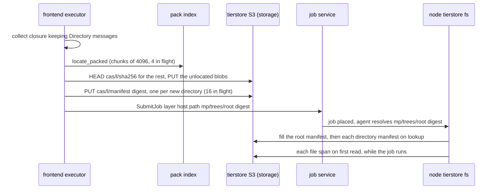
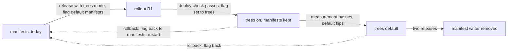
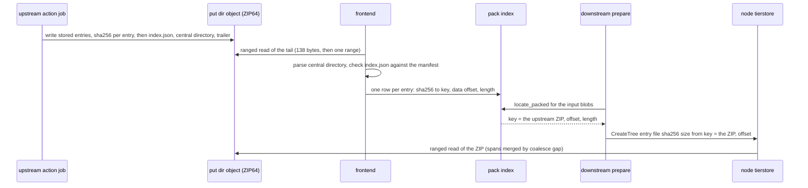

# Action input trees created on the job's node, through tierstore's trees API

Status: **DESIGN, for the owner's review (2026-11-15), revised after review round 1 (section 13). Nothing is built; this pull request adds this file and one pointer line.**

**Superseded** by jobscheduler's mount providers (komira-ai/jobscheduler#896): the frontend no longer calls the
host's tierstore after reading the job. It names the action tree, one tierstore tree list, before it submits and writes it beside the submit, and
the job's layer names tierstore's mount provider, which the host's agent asks for the tree as soon as the job is
assigned. What kbf builds is [actions-as-jobs.md](actions-as-jobs.md), 4.7; the rest of this file is kept as the
record of the problem (sections 2 and 3).
Written against kbf `main` at `84086187e`, tierstore `main` at `b8ae6457` (its design
[node-local-trees.md](https://github.com/komira-ai/tierstore/blob/main/docs/design/node-local-trees.md) merged as komira-ai/tierstore#320; the
tracking issue is komira-ai/tierstore#326) and the jobscheduler revision kbf pins (`60b75be`). What this file says of today is marked **read**
(from that code or document), a figure from a run is **measured**, a figure worked out from them is **inferred**; a number with none of the
three is a default this design proposes, and every such number is a config key (section 4.2). Terms in bold are those of tierstore's
glossary. "The farm" places an action on a *virtual worker* of the executor; "the job service" is jobscheduler, which places each job on a *host*.

This document is a living problem-to-solution document: section 1 is the answer in one page, section 2 the problem, section 3 the finding that
shapes everything else, and sections 4 to 10 the design, flow by flow, with its latency budget, its model check and its landing order. Open
questions, each with a recommendation, are at section 12; the review of round 1 and its answers are section 13.

Linked from [jobs-on-jobscheduler-and-tierstore.md](jobs-on-jobscheduler-and-tierstore.md) and
[one-pass-task-object.md](one-pass-task-object.md); the latter's "tierstore side" (its section 3) describes today's code until PR 7 of section 10.

## 1. The answer in one page

- **What changes for the build.** Today the frontend writes one JSON *manifest* per directory of an action's input root to tierstore with plain
  create-only S3 PUTs (`cas/l/<sha256 of the manifest>`), and the job's root is `<mp>/trees/<digest>`, resolved lazily on the node by
  `tierstore fs`. After this design the frontend sends **one `CreateTree` call to the tierstore of the host the job was placed on**, naming every
  file of the input root as a *span* (object key, offset, size) of an object tierstore can already read, and the job's root is the path the call
  names, `<mp>/jobs/<job id>`. No manifest is written to a store. Nothing about the Command, the action or the output changes.
- **Where the metadata in the ZIP is used.** An action's one-pass output object is a ZIP64 archive whose central directory the frontend
  already parsed once at ingest into the pack index, one row per file: `digest -> (object key, data offset, length)` (read:
  `record_put_dir_pack`). A downstream action's input file is that row. So its tree entry is `{path, sha256, size, mode, from: {key: <the
  upstream action's ZIP>, offset}}`: **a span of the upstream ZIP, with no copy and no `cas/l/` write**, and the frontend reads no ZIP bytes
  when it builds the entry (section 5).
- **Finding that decides the design (section 3).** The task text assumed the frontend learns the node during `prepare`. It does not: `prepare`
  runs before `SubmitJob`, and the job service chooses the host after it, with no way for a client to name one (read: `Constraints` has no host,
  `Job.host_id` is empty until `PLACED`, the API has no watch). The earliest moment the frontend can call a node is **the first read of the job
  that shows `host_id`**, which is jobscheduler's own documented hook (`job-rootfs.md` 7.3). The design therefore (a) builds the request in
  `prepare`, before the submit, (b) names the job's root by *job id*, a path known before the host is, (c) calls the host's tierstore on first
  seeing `host_id`, and (d) needs tierstore's `fs` lookup of that path to **wait** for the placement (bounded, below jobscheduler's 60 s lookup
  bound) instead of failing at once, and a `wait` create to make its placement visible at a deadline (20 s) even when its fills are unfinished, so a
  cold node cannot fail the lookup (4.6).
- **Recommendation on "should jobscheduler call `CreateTree` itself" (Q1).** No, for now: the frontend calls. Section 3.3 weighs it. The short
  version: the request is megabytes and kbf-specific (it would travel through the job service's state), the per-node dedup memory lives in the
  frontend, and jobscheduler is held to "generic only"; its advantage (no poll, no race, the key stays on the host) is real, and section 6 says
  which measurement would reverse the recommendation. Nothing in the design makes the move expensive: only the caller changes.
- **Prefetch.** `wait` by default (tierstore's default), bounded by a 20 s deadline after which the rest fills in the background: the job starts
  with its bytes local or filling, never held for a whole transfer. A tree whose total size exceeds `--executor-trees-wait-max-bytes` is created
  with `background`. Latency on the start path is in section 6.
- **The old path.** Kept, per frontend, behind `--executor-input-tree manifests|trees` (default `manifests` until the measurement of section
  10 passes). It cannot be a per-node fallback, because the path the job names is fixed at submit, before the node is known (section 4.9).
  Removed two releases after `trees` is the default.
- **One-pass as the farm default.** A separate, later change, after the measurement of section 7 with trees on; independent of this design
  (trees work over packs too), better with it (fewer, larger source objects per action: fewer ranged reads on the node).
- **tierstore proto client.** A new crate `kbf-trees-client`, a typed tonic client with an in-process fake, built over a proto crate that
  tierstore publishes and kbf pins at one revision, the way `kbf-job-client` is built over jobscheduler's `js-proto` (section 8).
- **Failure is settled only on a confirmed job state.** A failed create cancels the job and the lease is settled only after the job is seen
  terminal; a job service that cannot be read holds every decision; a release of a live job names a generation, so a late release removes nothing
  newer (4.5, 4.8, models 2 and 3). Deterministic failures settle `Invalid`, not a retry loop (4.7). The frontend sends and verifies no tree
  digest (4.4), so the kbf and tierstore release trains stay independent.
- **What the owner must decide** is in section 12. The ones that block code: Q1 (who calls), Q2 (tierstore's `fs` lookup waits and the wait
  deadline) and Q13 (deploys with no downtime).

## 2. The problem (read)

### 2.1 The flow today



(read: `action_tree.rs` `TreeWriter::write`, `action_tree/place.rs`, `executor/submit.rs` `put_dir_spec`, `executor/out.rs` `PutDirRoots::layer`.)

What this costs and why it is wrong for the owner's direction:

1. **Each new directory is a create-only PUT of a small JSON object** on the prepare path (`WRITES_IN_FLIGHT` 16). The memo (`memo.rs`, 100,000
   entries, 600 s) skips a directory the writer built lately; every other action pays the PUTs.
2. **The manifest is a tree only for one interface.** Through the S3 interface `cas/l/<digest>` is JSON and nothing more (tierstore's
   node-local-trees.md, section 1).
3. **The digest covers `source`** (where the bytes are), so the same input root from two pack layouts is two trees, and a repack orphans
   every manifest that named the old place.
4. **Every file is first read lazily, while the job runs**, from the job's wall clock (jobscheduler `job-rootfs.md` 7.4: "a lazy input is paid for
   while the job runs").

### 2.2 What the owner decided (2026-11-15, komira-ai/tierstore#326)

A tierstore `trees` interface, separate from S3, gRPC with types defined in proto, TLS-capable, authenticated by the existing tierstore keys.
`CreateTree` names explicit locations (an S3 bucket and prefix and/or an `fs` path); the tree is node-local; each file is a span of a cached
object; `prefetch` is `none | background | wait`; every file has a required `sha256` and a full Unix mode; the tree is read through plain S3
GET, HEAD and LIST and through the `fs` interface. The frontend runs on the NUC; jobs run on build nodes chosen by jobscheduler; jobscheduler
mounts an opaque host path read-only.

Note for the reader of tierstore's merged design: node-local-trees.md (#320) still describes the carrier as `POST /<bucket>?tree` on the S3
listener. The owner's decisions above supersede that carrier (issue #326 says so: "not on the S3 interface; a separate API"). This document
follows the decisions. The parts of #320 that do not depend on the carrier (the digest, the entries, `prefetch`, placements, lifetime, the
validation table, the failure table) are used as written and named by section.

## 3. The finding: the node is not known when the frontend prepares

### 3.1 What is known when

| Moment | What the frontend knows | Read from |
|---|---|---|
| Farm `Start` on a virtual worker | the lease, the action, the booking; **no host** | `executor/runs.rs` (`Waiting`), `pool.rs` ("the farm places on workers, and the job service decides where each job runs") |
| `prepare` (`submit.rs::prepare`): action facts, key mint, `ingest.mint` writes the tree, `inputs.tree` | the input closure, every blob's place; **no host** | `front.rs::mint_put_dir`, `submit.rs` lines 211 to 228 |
| `SubmitJob` | the job spec, final: `layers`, `mounts`, `needs`, `constraints` (os, arch, exec, isolation: **no host, no host label**) | jobscheduler `job.proto` `Constraints` |
| `GetJob` shows `PLACED` | `host_id`, from the commit of the placement; the start leaves for the host on its **next heartbeat** | jobscheduler `job-rootfs.md` 7.1 |
| The agent's `STARTING` | the agent resolves each host path (60 s bound each; a path that is missing fails the start at once as `input-unavailable`) | `job-rootfs.md` 4.7, 7.2 rules 3 to 5 |

So the task text's "the executor has a prepare step after placement ... the frontend learns the node then" holds for the farm's placement on a
virtual worker, which names no host. The frontend can name a host only after `SubmitJob`. A host path layer must be fixed at submit
(`JobSpec` is immutable), and a path that does not exist when the agent first looks fails the job `input-unavailable` after at most 60 s
(or at once). Rule 2 and rule 1 add: the frontend may see a later state than `PLACED` on its first read, and a job may be requeued to another
host (the start timeout, 900 s by default, counts from placement).

The API has no watch: jobscheduler decided so for the hook ("this design adds no watch", LR12), and the executor reads each job once per
`Config::poll` (default 1000 ms, read: `config.rs`). A frontend that reacts to `PLACED` as soon as it can reads often while a job is
`QUEUED` or `PLACED` (`job-rootfs.md` 7.3 says exactly that).

### 3.2 The options

| | Who calls, when | Needs from others | Start-path cost | Verdict |
|---|---|---|---|---|
| **A. The frontend, in `prepare`, as the task text says** | before the submit | a host, which does not exist yet | none | Not possible: no host to call. |
| **B. The frontend, on the first read that shows `host_id` (recommended)** | after `PLACED`, before or while the agent resolves the path | `fs` lookup of `jobs/<job id>` waits for the placement (Q2); the layer path names the job id | one poll delay plus one call, **overlapping** the heartbeat that carries the start and the agent's own preparation | Recommended. |
| **C. The frontend pins the host first** (a `host` constraint, then create, then submit) | before the submit | a new jobscheduler field and a way to choose a host, i.e. kbf scheduling placement itself | none on the start path, but the frontend picks hosts | Rejected: B15 (kbf scheduling is measured, not reserved) and the owner's "jobscheduler chooses". |
| **D. jobscheduler calls `CreateTree`** (a generic start hook on the agent) | on the host, in `STARTING`, before the lookup | a new generic field on `JobSpec` carrying the call; credentials on every host; the request passes through the job service | no poll, no race | Not now; section 3.3. |

### 3.3 Why the frontend calls (Q1), and what would change the answer

For D:

- it knows the host exactly, with no address mapping (Q6) and no poll;
- the call is on the host (loopback or a unix socket), so the tierstore key would live on each host and not on the NUC;
- no `fs` lookup wait would be needed if the agent's hook ran before the lookup.

Against D, and for B:

1. **The request is large and kbf-specific.** About 45 bytes per file entry (inferred, tierstore's estimate): 100,000 files is about 7 MB. A job
   spec travels through the job service's state store on every submit and is kept (`Job.spec`); jobscheduler's records are small and
   replicated. To keep the request out of the spec, jobscheduler would have to be given a *reference* (an object to fetch), which is the
   manifest-in-a-store design the owner is moving away from.
2. **The dedup bookkeeping is the frontend's.** Which subtrees exist on which node (section 5.3) is memory of what this frontend sent where;
   jobscheduler cannot answer `unknown child` for it.
3. **jobscheduler is held to generic only** (AGENTS.md R5 of both repositories: it never depends on kbf crates). A generic "call this local
   gRPC method with these bytes" hook is possible, but it is a new feature of a different repository, with its own credential and failure
   semantics (a call that fails must map to one of its start failure codes), before anything here can be measured.
4. **Failure handling is richer in the frontend**: it retries, resends a child inline, cancels, and settles the lease with a reason
   (section 4.7). The agent could only fail the start.
5. It needs **no change to jobscheduler**, and it is the shape jobscheduler documents for exactly this (7.3). A later move to D changes the
   caller and nothing else: the request, the location and the `fs` path are the same (the one-way doors are fixed once, section 4.3).

What would reverse the recommendation, to be read from the measurement of section 7: if, at the 95th percentile, the interval from
the `PLACED` commit to the frontend's call being sent is longer than the agent's own preparation before it looks up the path (so the *job
waits on the tree* for a reason that is the poll, not the work), ask jobscheduler for one of two small generic things, in this order: a
`GetJob` that waits for a state change (a long poll: additive, useful to every client), then the start hook of D.

## 4. The design

### 4.1 The flow

```mermaid
sequenceDiagram
    participant F as frontend executor
    participant J as job service
    participant A as host agent
    participant N as node tierstore trees API
    participant FS as node tierstore fs
    participant S as upstream tiers
    Note over F: prepare, before the submit
    F->>F: closure, locate spans in the pack index, build the entries (no host yet)
    F->>J: SubmitJob layer host path mp/jobs/job id, mount put dir
    J-->>F: Queued
    loop every placement poll until host_id is shown
        F->>J: ListJobs, placed jobs without a tree
    end
    J-->>F: Placed on host h
    J->>A: start, on the next heartbeat
    par frontend creates the tree
        F->>N: CreateTree entries, at fs jobs/job id, prefetch wait, ttl (children first, then the parent)
        N->>S: ranged reads of the source objects, coalesced, verified
        N-->>F: tree digest, placement, generation, counts, filled
    and agent starts
        A->>FS: look up mp/jobs/job id
        FS->>FS: no placement yet, wait (30 s); visible at the fills or the 20 s deadline
        N->>FS: placement made, lookup answers
        FS-->>A: the directory
    end
    A->>A: mount the layer, run the job
    F->>J: GetJob, ended
    F->>N: ReleaseTree location, at the end (by generation if requeued)
```

Everything that does not depend on the host is done in `prepare`, as today (closure walk, pack-index asks, writing the unlocated blobs to
`cas/l/`, the limits of `NoTree`). What `prepare` no longer does is write manifests. What it keeps is the *entries* of the tree in memory
(`TreeRequest`, section 4.4). This is **not** today's bound: `KeptClosure` is dropped when the preparation ends, while the request is held until
the create succeeds, which spans the job's queue wait, and queued jobs are past `prepare_concurrency`. It is bounded by
`--executor-trees-parked-bytes` with a rebuild at placement above it (7.1).

### 4.2 Who calls, which node, which credentials (config)

The caller is the executor of the frontend (`kbf-server/src/executor`), one new stage between `Submitted::Running` and the job's first run read.
Every number is a flag with a default (AGENTS.md S2: flags, not environment; the key is secret material in a file).

| Flag | Default | Meaning |
|---|---|---|
| `--executor-input-tree` | `manifests` | `manifests` is today; `trees` is this design. Per frontend, flipped by an operator (section 4.9). |
| `--executor-trees-address-label` | `tierstore-trees` | The host label (read through the job service's `ListHosts`) that holds the host's tierstore trees address, `host:port`. It is set in the host's package configuration, the one place that knows the address of that host's tierstore. A host with no such label is a named deterministic failure (4.7), never a guess. Q6. |
| `--executor-trees-address-template` | none | An opt-in for a fleet whose host ids resolve and that runs one tierstore per host: `{host_id}:{port}`, used only for a host with no label. |
| `--executor-trees-key-file` | none; required with `trees` | The tierstore key (secret material, mode 0600, read like `--executor-job-token-file`). Q5. |
| `--executor-trees-ca-file` | none | A CA to pin for TLS to the nodes. |
| `--executor-trees-allow-plaintext` | off | Without a CA, a call to an address that is not loopback is refused. This flag is the explicit, logged opt-in (a line at start and one at each node's first channel). |
| `--executor-trees-prefetch` | `wait` | `none`, `background` or `wait`, the mode of a create. |
| `--executor-trees-wait-max-bytes` | 1 GiB | A tree whose file bytes exceed this is created with `background` whatever the mode says. Tuned by the measurement of section 7. |
| `--executor-trees-ttl-secs` | 1800 | The `ttl` of the create: it only has to outlive the time to the mount's attach, which holds the placement from then (tierstore 7), so twice the job service's start timeout (900 s, read). |
| `--executor-trees-placement-poll-ms` | 100 | How often the frontend's jobs that are placed and have no tree yet are listed (7.1 for the load). |
| `--executor-trees-attempts` | 3 | Calls of one create before the job is cancelled (transport and busy answers only). |
| `--executor-trees-backoff-ms` | 200 | The first wait between attempts; doubled each time; a `Retry-After` of the answer replaces it. |
| `--executor-trees-call-timeout-secs` | 40 | One call's bound: above tierstore's `trees.wait_deadline` (20 s) plus its validation, so the node's own answer comes first (4.6). |
| `--executor-trees-child-min-entries` | 256 | A subtree with at least this many entries is created as its own tree and named by reference (section 5.3). |
| `--executor-trees-resident-entries` | 100000 | The bound of the memo of which trees a node has (section 5.3). |
| `--executor-trees-parked-bytes` | 1 GiB | The most memory the requests of jobs that wait for a host may hold; above it a request is not kept but rebuilt when the job is placed (7.1). |
| `--executor-trees-infra-limit` | 5 | The most `Infra` settles of one action's tree creation inside the directory memo's window before the next is a named failure instead (4.7). |
| `--executor-trees-sweep-secs` | 300 | How often (and at start) the frontend releases the placements of ended jobs on the nodes (4.8). |

**Which node.** The host id of the job's read gives the host; the host's label gives the address (`host:port` of that host's tierstore trees
interface), read through `ListHosts` and kept per host, refreshed on a miss and at each sweep. A host id is therefore never taken for a name,
and a host that runs several tierstores or a Mac whose address the NUC cannot resolve carries the address that works. The frontend on the NUC
reaches a Mac only if the Mac's tierstore listens on an address the NUC can reach: a listener on loopback only is a Mac package configuration
mistake and shows as the deterministic failure "host h has no reachable trees address" (Q12). A job that is requeued shows another `host_id`;
the stage creates again there (4.5). One channel per node is kept (HTTP/2 multiplexes the creates of one node); channels idle for a minute are
closed (inferred need; the number is part of the PR, as a flag).

**Which credentials.** One tierstore key file for the whole fleet, read by the frontend only, never logged, never in a job spec (the job has
no network and no file of it: unchanged, B16). tierstore's rule (#326, "defaults taken") is that only the full key may place a tree at an `fs`
path, so this key is the full key of each node: the NUC frontend then holds a fleet-wide full key (Q5). **The key must not cross the LAN in
the clear.** Two rules: kbf refuses a call to a non-loopback address with no CA unless `--executor-trees-allow-plaintext` is set, and kbf
asks tierstore (section 11) to authenticate a call by a signature of the request made with the key, as S3's requests are, so that even an
opted-in plaintext channel never carries the key itself, only a signed request (the tree's names and spans are then readable on the wire, which
the opt-in accepts). Until the signature scheme exists the opt-in is not offered: a remote node needs TLS.

### 4.3 The mount path handed to jobscheduler

The job's one layer is the host path `<mp>/jobs/<job id>`, where `<mp>` is the mount point `--task-out-root` already derives (`<mp>/put`, so
`<mp>/jobs` is a sibling of `<mp>/trees`, as `PutDirRoots::trees` is today) and `<job id>` is `job_id(frontend, lease, 0)`
(`k<8 hex>-<term>-<seq>-<attempt>`, at most 62 bytes of letters, digits and dashes, read: `submit.rs`). The `CreateTree` names the same string
as its `fs` location: `{"interface": "fs", "path": "jobs/<job id>"}`. Properties:

- It is known before the host is, which is what makes B possible.
- The id is unique per frontend and attempt; a resubmit of the same id (the submit is idempotent on it) names the same location, and a create of
  the same tree at the same location is `created: false` (tierstore 3.3: idempotent), so a retry after a lost answer is safe.
- `jobs` is not one of the mount's own names (`trees`, `views`, `put`), so tierstore accepts it as a location (tierstore 3.2, "bad location").
- **The host agent must list `<mp>/jobs` as a read-only mount root** (`--mount-root-ro jobs=<mp>/jobs`), as it lists `trees` today
  (`out.rs` header). That is host configuration (the package that sets the agent's flags), done once before `--executor-input-tree trees` is
  set. A host without it refuses the start `input-not-allowed` by name (`job-rootfs.md` 2.6: a configuration mistake, fixed in the
  configuration).
- The S3 location of the create is **not** named: kbf reads trees only through the mount. An S3 location needs the empty-prefix LIST and the
  write grant of the prefix and buys nothing for a job. Q10.

The one-way doors of this section (the string `jobs/<job id>`, the `fs` location kind, the key and the proto message) are the ones fixed once:
they are the same under D, and under a later change of address mapping.

### 4.4 The tree entries, from the REAPI input root and the spans

`prepare` builds a `TreeRequest`: the list of entries `CreateTree` takes (tierstore 3.2). **It computes no tree digest and sends none.** The first
version computed the digest `T` with tierstore's builder in kbf's pinned library and had the node verify it, which made a node upgraded to a new
builder refuse every create of an older kbf (10.1); now the node computes `T` from the entries and returns it, and the frontend uses only the
returned value, to name a child (5.3). Entries come from the kept closure (`KeptDirectory`: files with `(name, digest, exec)`, directories, symlinks) walked to full paths:

| REAPI node | Tree entry |
|---|---|
| `FileNode` | `{path, kind: file, sha256, size, mode, from}` with `mode` `0755` if executable else `0644` (REAPI carries no more; `node_properties` are refused as today, `NoTree::NodeProperties`) |
| empty file | `{path, kind: file, sha256: e3b0c442..., size: 0}`, no `from`, nothing to fetch |
| `DirectoryNode` | implied by the paths below it; an empty directory is `{path, kind: dir}` |
| `SymlinkNode` | `{path, kind: symlink, target}` |
| the base tree | its top-level files are file entries; each top-level directory is a `tree` entry naming the digest the node returned when that directory's tree was created on it (5.3). The entries of the base's own trees, needed only to create them on a node that lacks them, are derived from the manifests of the release's base-tree bundle, which `base_publish.rs` already reads and writes as `cas/l/<sha256>` objects (read), so each base file is a whole-object entry with no `from`. **That is a read of `cas/l/` manifests** that this design keeps: once per process and base release (memoed), with a cost in 6.1; the base publish may record the entries instead (Q4) |
| `.kbf/action`, `.kbf/command`, `work` | the same names and blobs as today (`ADDED_ENTRIES`), as files and directories of the one request |

**`from`, the span.** For each distinct non-empty blob the frontend asks the pack index (`locate_packed`, as today) and takes the first of:

1. **A pack-index row** `(key, offset, length)` with `length == size`: `from: {key, offset}`. This is where the ZIP's metadata arrives (section 5).
2. **A whole object** `cas/l/<sha256>` of the blob's length (a HEAD, as today): no `from`; tierstore reads the whole object.
3. **Neither:** the blob is written to `cas/l/<sha256>` through the existing hash-while-streaming writer (`place::write_whole`, B16: read once, no
   whole-file buffering), then as 2.

An object of another length at `cas/l/<sha256>` stays `NoTree::WrongLength`. This reuses `place::locate` and `place::write_whole` unchanged;
the manifest encoder (`encode.rs`) and `write_manifest` are what the `trees` mode stops calling.

**Tree identity.** The node's tree digest covers names, kinds, modes, symlink targets and each file's `sha256` and `size`, and *not* `from` (tierstore
D3). So the same input root has one digest on a node whether its files are spans of packs, of one-pass ZIPs or whole objects. The frontend does
not compute it; its memos are keyed by the REAPI `Directory` digest and hold the node's digest per node (4.10). The format of the source object
still does not enter the tree.

**Limits.** `NoTree::TooManyEntries` and `TooDeep` keep their meaning, with tierstore's `trees.max_entries` and `max_depth` (the library
exports them as `MAX_ENTRIES` and `MAX_DEPTH` today); `trees.max_request_bytes` bounds a request, and a request over it is split by the child
rule of section 5.3 or refused by name.

### 4.5 The frontend's stage, step by step

For a job in `trees` mode, after a successful submit, per poll pass (at `--executor-trees-placement-poll-ms` while any job waits for its tree):

1. **Read.** One `ListJobs` of this frontend's jobs that are placed or later and have no tree yet (7.1 for why it is a list and not a read per
   job); a job whose tree exists is read as today, at the executor's own poll. A job that is `QUEUED` is not in the list: no host, nothing was
   created, so a job that waits for capacity costs the job service and the nodes nothing per pass. **A read that fails decides nothing**: no
   create is judged lost, no job is cancelled or settled on it; the state is the last one seen and the next pass reads again (a job service
   or its Postgres that is down or flapping holds every decision, it never makes one).
2. **Create.** The first read that shows a `host_id`: resolve the address (4.2), send `CreateTree` (4.1) with the entries, the `fs` location,
   `prefetch`, `ttl`. No digest is sent (4.4).
3. **Success.** Keep `(host, location, generation)`, where the generation is what the answer returned for *this* call (4.8), remember the
   children as resident (5.3), mark the job `treed`. The job needs nothing else from the frontend.
4. **Requeue.** A different `host_id` later (`job-rootfs.md` rule 1): create on the new host first; then release the old placement **by its
   `(location, generation)`**, never by location alone, so that a release that arrives after a later create at the same (host, location) removes
   nothing (4.8, model A of section 9).
5. **End.** When the job's terminal state is observed, release by location on every host created on (a terminal job id is never created for
   again, so the location alone is safe), best effort; the sweep (4.8) and the `ttl` catch a lost one.
6. **A create that fails for good** (the table of 4.7): send `CancelJob` and repeat it, with backoff, until a read **shows the job terminal**.
   The lease is settled **only on that observation**, never on having sent the cancel:
   - `CANCELLED`: settle as the table says (`Infra` or a named failure); only now may the farm submit attempt N+1, so two jobs of one lease are
     never alive together (model B of section 9).
   - the job ran anyway (a cancel that raced the start, or a create whose reply was lost and which applied): it is settled **from its own
     result**, as any job is, and no second attempt is made.
   - the job service does not answer: hold. The lease stays unsettled, the cancel is retried, a held-lease count is exported; nothing is
     decided on the strength of an error.

### 4.6 Prefetch: `wait` or `background`, its deadline, and its latency on the start path

`wait` makes the call return when every range is in the node's cache and pinned, so no open of the job waits on the network; `background`
returns once the placement exists and the pulls are queued, so the job starts at once and a first read of an unfilled range joins the fill
(tierstore 5.1). The cost of `wait` is placed on the start path *by design*: it is the time the bytes would otherwise take from the job's wall
clock. The choice, per create:

- `wait` for a tree whose file bytes are at most `--executor-trees-wait-max-bytes` (default 1 GiB). Most action inputs are the base tree
  (already on the node after the first job: a `tree` entry, no fill) plus the action's own inputs, which are the outputs of the actions just
  before it in the build (warm on the node if it ran them, otherwise one read of the upstream ZIP, which the one-pass format makes one coalesced
  range, section 5).
- `background` above it, so one huge input does not hold a job's start for its whole transfer.

**The wait is bounded below the agent's lookup, and a cold create never turns into `input-unavailable`.** The first version of this design
had the agent's lookup wait (30 s) shorter than a cold `wait` create (call bound 150 s), so a cold node could answer `ENOENT` while the create
was still filling, fail the job `input-unavailable`, settle `Infra`, and meet the same cold node again. The placement is now made visible by
the node **when the fills finish or when `trees.wait_deadline` passes, whichever is first**; at the deadline the remaining fills continue as
`background` (a first read of an unfilled range joins its fill) and the answer says `filled: false`. The bounds are one chain, each below the next:

| Bound | Default | Whose |
|---|---|---|
| `trees.wait_deadline`: a `wait` create makes its placement visible after at most this | 20 s | tierstore config (asked, section 11) |
| `fs` lookup of a path under `jobs/` with no placement yet waits at most this, then `ENOENT` | 30 s | tierstore config (Q2) |
| the agent's lookup bound for a host path | 60 s | jobscheduler (read: `job-rootfs.md` 7.2) |
| the frontend's call timeout | 40 s | `--executor-trees-call-timeout-secs` |

A cold create of 45 s therefore makes the placement visible at 20 s and the job starts with its reads joining the fills; it is not a failure. The
lookup answers `ENOENT` only when no create reached the node within 30 s of the agent's first lookup, which is a dead frontend or a dead
node, not a cold one, so a cold node cannot fail jobs in a loop. Tierstore validates `wait_deadline < lookup wait` at its own start; the pair is
checked once, in its configuration (B20). What `wait` buys is bounded: at most 20 s of start path moved off the job's wall clock, with the
node's fills coalesced and no open of the job waiting on a connection; what it cannot buy is a start held for a whole transfer.

The latency of each is in section 6. The choice of 1 GiB is a guess to be tuned by measurement; it is a key so the tuning needs no release.

### 4.7 Failure and retry

All calls are idempotent by (tree, location) (tierstore 3.3), so a retry sends the same request. Four classes of answer, and a bound over all:

- **Retry**: the same request again, up to `attempts`, doubling `backoff`. Only transport and busy answers.
- **Repair once, not counted**: a fix that is not a repeat, tried one time.
- **Deterministic**: the same request fails the same way on every node and every attempt, so the action is **not** re-run: the lease is settled
  `Invalid` (the farm's `Settled::Invalid`, "the action cannot run here: the caller's to fix", read: `outcome.rs`) with the reason by name.
- **Infra**: the farm may run the action again, a new attempt and a new job id.

Every row ends in `CancelJob` and a settle only after the job is seen terminal (4.5 step 6). **The bound over all:** more than
`--executor-trees-infra-limit` (5) `Infra` settles of one action's tree creation inside the directory memo's window settle the next as a
deterministic failure naming the last reason, so no unclassified refusal can loop.

| What the node answered | Class | Then |
|---|---|---|
| connection refused, reset, timeout, `UNAVAILABLE`, `DEADLINE_EXCEEDED` | retry | exhausted: `Infra` "tree not created on host h: ..." |
| busy / resource exhausted with `Retry-After` (tierstore 503 busy, 429 placements) | retry (counts) | as above |
| the answer says `filled: false` (the wait deadline passed, 4.6) | success | nothing: the job starts, its reads join the fills |
| unknown child tree (a `tree` entry's child is not on the node) | repair once | forget the resident entry, send the child's entries inline (5.3); a second unknown child: `Infra` |
| the host has no address label, or no `ListHosts` row | deterministic | `Invalid` "host h has no tierstore trees address": a configuration mistake, fixed in the configuration (B20) |
| permission denied (403), unimplemented or the interface off (501) | deterministic | `Invalid` naming the missing grant, or "the node's tierstore has no trees interface"; no per-node fallback exists (4.9), the deploy check (4.9) prevents it |
| tree too large for the cache (507) under `wait` | repair once | the same create with `background`, which pins what has been read so far (tierstore 5.1; to be confirmed there, section 11); a second 507 is deterministic: `Invalid` "input tree of N bytes does not fit the cache of host h". The fleet's `pin_limit` is one deploy value; a node smaller than the rest is a deploy mistake |
| refusal by a limit: too many entries, too deep, request over `max_request_bytes` | repair once for the request size (split by the child rule of 5.3); deterministic otherwise | `Invalid` naming the limit and the tree's figure |
| conflict (409) for an id this frontend made | deterministic | a bug: `Invalid`, logged, counted |
| source missing (`upstream 404`): a span's object is gone | repair once | drop the pack-index rows that name that object and the memos of the directories that used it (5.4), then `Infra`; the next prepare no longer finds the blobs located, so they are written whole from where they exist or are reported missing the way a missing blob is today (the producer runs again). A second 404 for the same action is deterministic |
| mismatch or short (tierstore 422): the bytes are not the entry's `sha256`, or the object is shorter | producer fault | 5.4: the producer's output is marked bad and its action entry is dropped, so the producer runs again; the consumer settles `Infra` once; a repeat for the same source object fails the consumer by name |
| bad request (400) from the node's validation of a request kbf built | deterministic | `Invalid`, logged: a bug of this frontend |
| the frontend restarts, or a new process takes over | n/a | any process may release the placements of a terminal job (4.8); what a new process does with the earlier process's live jobs is the executor's own rule and Q13, not decided here |

A job whose tree was never created fails `input-unavailable` at the agent only by the lookup bound of 30 s (4.6), which the executor settles as a
failure of the host's input, not of the action. The cancel above makes that the rare path.

### 4.8 Lifetime, release, generations, and deploys

A placement lives from the create until `ttl` (1800 s default) after the last reader leaves, and while any mount holds it: the agent's
lookup attaches the path (tierstore 7), so a running job holds its tree. At the job's end the frontend releases it (4.5 step 5); tierstore
drops the record and unpins the packs, which stay in its cache until evicted, so a tree placed again soon after is warm.

**Generation.** A create at a (host, location) that already has a placement is idempotent and returns that placement, so a release keyed by the
location or the placement id could remove a tree a newer create is about to hand a mount (job on A, then B, then A again after a start
timeout: the release of A's first placement can arrive after the third create). Every create therefore returns a **generation**, a counter of
the creates at that location that the node bumps on each call, and the release of a live job names `(location, generation)`: the node removes the
placement only if that generation is still current. A late release of an old generation removes nothing. A release **by location alone** is
allowed only for a job seen terminal, because no create follows a terminal job's id. Tierstore carries the generation (section 11).

**Sweep, for leaks and deploys.** At start and every `--executor-trees-sweep-secs`, for each host with the address label the frontend asks the
node for the placements under `jobs/k<its frontend id>-` and releases by location each whose job is terminal in the job service, or unknown to it
and older than the start timeout. It needs no memory of the process that made the placement, only the job id in the location. Two processes of
one frontend id run the same sweep and release only terminal jobs; frontends with different ids have different prefixes and never touch each
other's. So a rolling deploy leaks nothing beyond the sweep interval, creates nothing that depends on one process being alive, and the design adds
**no singleton or leader rule**: two frontends run side by side.

**What a deploy does to jobs is the executor's rule, not this design's.** Today's executor (read: `executor/mod.rs`) runs on exactly one frontend
id and cancels the live jobs an earlier process of that id left, which is a restart-with-loss, not a no-downtime deploy. Trees mode neither adds
to that rule nor needs it. What a replacement process needs to *adopt* a job instead of cancelling it is a proof that the job's tree exists, and
the design provides it: the location is derived from the job id and the node answers a read of `jobs/<job id>` with the placement (section 11).
The change to adopt (Q13) is the executor's, with its own design; until then a deploy re-runs the jobs in flight, and their placements are
released by the sweep.

### 4.9 What happens to the `cas/l` manifest path, and the cutover



- **Kept as the fallback during rollout, per frontend.** `--executor-input-tree manifests` is today's code path exactly: `TreeWriter::write`,
  `encode.rs`, `place::write_manifest`, `<mp>/trees/<digest>`. A job names its layer at submit; the node is unknown then, so the choice
  cannot be per node (the per-call fallback of tierstore's 8.3, on an `unknown POST` answer, needs a node to ask first). It is per
  frontend, made by the operator.
- **The check before the flip is a deploy step, not runtime machinery** (B20; and tierstore is a proxy: no probes of the store): before
  setting `trees`, the operator confirms every build node runs a tierstore with the trees interface, carries the address label (4.2), and lists the `jobs` mount root. One
  check, once, in the rollout runbook; a node that was missed shows as `Infra` settles that name it (4.7).
- **Reversible.** Setting the flag back to `manifests` and restarting changes only jobs submitted after the restart; jobs in flight keep
  their layer (the executor cancels earlier processes' live jobs at start anyway). Manifests written before stay readable by the node
  (tierstore D10, B8). The agent's mount root for `jobs` is additive.
- **Removed after.** Two releases after `trees` is the default (the same schedule as tierstore's `hydrate` retirement, its 8.2), a pull request of
  its own deletes the manifest writer (`encode.rs`, `write_manifest`, the memo's manifest digests); `place::locate` and `write_whole` stay.
  tierstore keeps reading v1 manifests (its D10). No format is removed in kbf: the manifest was never a format kbf's other processes read.

### 4.10 The two memos

`memo.rs` today maps a `Directory` digest to its manifest digest and the subtree's measure, good for 600 s on the writer's clock. In `trees`
mode there are two, both bounded and both in the frontend, and neither holds a tree digest the frontend computed:

1. **Directory memo (node independent).** `Directory digest -> measure, children, spans' source key, expires`. It still expires (600 s) so that the
   *spans* a rebuilt request names are not older than the pack index's answers, and it is dropped for a key whose object turned out missing or
   bad (4.7, 5.4).
2. **Resident memo (per node).** `(host, Directory digest) -> (the node's tree digest, expires)`: "tierstore on `host` has this directory as the
   tree whose digest *the node returned*", set when a create returned and bounded by `--executor-trees-resident-entries`. It is advice: a stale
   entry costs one `unknown child` answer and one inline resend (4.7), never a wrong job, and tierstore pins a child while a parent that names it
   lives (tierstore 3.2), so a resident entry is true for at least as long as the last placement that used it.

## 5. The tree from an upstream ZIP, and shared subtrees

### 5.1 Where a downstream input's span comes from



(read: `one-pass-task-object.md` sections 3 and 5, `proxy/packed/commit/untrusted/one_pass.rs`, `output_index.rs`.) Three facts the design
relies on, each checked in the code:

- **The data offset is already the pack-index offset.** The one-pass reader computes a blob's offset from the central directory alone (a
  local header is `30 + name + 20` bytes), which is the first-data-byte offset tierstore's `offset` wants (tierstore 13 asked the frontend to
  record exactly this). No local header is read at tree-build time (the ingest checks that the members chain, 5.4), and no ZIP is read at all: the one ranged read at ingest is the whole cost,
  paid once per action output, not once per downstream consumer.
- **The member's sha256 is the REAPI digest.** The ZIP's private extra field `0x4B42` holds the SHA-256; the REAPI `FileNode` digest is the
  same value; the pack-index row is keyed by it. So `sha256` of the entry, the ZIP's, and the index's agree by construction **as claims of the writer**, and a lying
  object is caught by tierstore hashing the span as it fills (422); 5.4 says what the frontend then does and what it checks at ingest.
- **`mode`** is the REAPI executable bit (`0755`, `0644`): `.kbf/index.json` carries `exec` and not a full mode, and REAPI inputs cannot say more.
  A full mode through the ZIP is an additive field of `index.json` (B8: a reader skips unknown fields) and is not needed by any action input
  today. Q11.

What changes between packs and one-pass for a tree: with packs, a blob is a span of one of at most 8 packs, or a whole `cas/l/` object when it is
over the cap; with one-pass every blob of an action's outputs is a span of its **one** ZIP. For a downstream action with inputs from `k`
upstream actions the node reads about `k` objects instead of up to `8k + large`, and the spans of one ZIP merge (tierstore's
`trees.coalesce_gap`, 256 KiB, one GET if adjacent; the ZIP adds 68 bytes of header and 24 of descriptor between members, read:
`one-pass-task-object.md`). That is the reason to switch the farm default, and the thing to measure first (section 7).

### 5.2 `publish_output` in `trees` mode

`TreeWriter::publish_output` today builds manifests of each output directory at ingest, writes them create-only, and remembers them so a
downstream input root that holds an equal subtree finds the memo. In `trees` mode it keeps the *remembering* and drops the *writing*: it
records each output directory's measure and spans' key from the derived `Directory` records in the directory memo (CPU only, no digest). The write that "costs the reuse, never the run" when a store refuses it disappears with the write. Where the
output is first used on a node, the request carries it as entries (or as a `tree` child, 5.3); nothing is stored for it.

### 5.3 Dedup of shared subtrees

Dedup happens at two levels, and only the second needs a protocol:

1. **Bytes: always, in tierstore.** Two files, two actions or two trees with one span are one fill and one cached range
   (tierstore 5.2, step 4). Sending the same entries twice costs request bytes and tierstore CPU, never a second fetch.
2. **Request size: shared subtrees.** A toolchain of 100,000 files is 7 MB (inferred) per create if sent flat. Such a subtree is a `Directory`
   every action of a language shares. The rule: a subtree with at least `--executor-trees-child-min-entries` entries (default 256) is created
   once per node as **its own tree** and named by `tree: <digest>` in every later request to that node, where the digest is **the one the node
   returned for the child's create**, kept in the resident memo (4.10). The frontend never computes a tree digest for the wire (4.4), so a node
   whose builder differs from any other in the fleet still works. The base tree is always one. A child is created like any tree (it needs a
   location, Q4: v1 uses `jobs/t/<hex of the child's Directory digest>`, so equal creates are idempotent and shared) with `prefetch` as the
   request's, and is pinned by every parent while the parent lives.

   Decision per create, per node: for each subtree above the threshold in the closure: if `(host, Directory digest)` is resident, name it by
   the node's digest; otherwise create it first. **The creates are sequential in one respect**: all the children of a job's request are created
   concurrently with each other, and the parent only after the last returns (it names their digests). The start path of a node's first job is
   therefore `max(child creates) + parent create`, not one create (6.2). The cost of a node's first job is one create per large shared
   subtree; every later job to that node names it.

The protocol that matters is the one between the resident memo (advice) and the node (truth): the model of section 9 covers it.

### 5.4 Trust in the ZIP's metadata

The span of a downstream input is taken from a ZIP an untrusted job wrote, and the frontend reads no ZIP data to build it. Two kinds of lie are
possible, and they are handled differently:

1. **The layout lies** (an offset or length that does not match the file). The ingest that fills the pack index (one ranged read of the tail,
   today) also checks, **without reading member data**, that the members chain: offsets strictly increase, each member's data ends exactly
   where the next local header starts (the writer's fixed 68-byte header and 24-byte descriptor, read in `one-pass-task-object.md`), the last
   member ends at the central directory, and the sizes sum. A `30 + name + 20` offset computed from a local extra field of another length shows
   as a gap or an overlap, and the output is refused at ingest as a failure of the producing action (an action failure by name, not `Infra`).
   PR 5b, before any use of the spans.
2. **The digest lies** (a wrong `sha256` for the bytes). Not checkable without reading them, and reading them at ingest is the second pass the
   one-pass format exists to avoid. The node catches it when it fills the span (422). That is **the producer's fault, not the consumer's**:
   the frontend drops the pack-index rows that name that object for those digests, drops the producer's action-cache entry that names it (the same
   effect as `EvictObjects` for that object, read: `storage.md`), cancels the consumer, and settles it `Infra` once. The consumer's next
   prepare cannot locate the blobs, so the producer runs again. A second mismatch for the same source object fails the consumer by name
   (`Invalid`: "input `<path>` from `<key>` does not hash to its digest") and keeps the object marked, so a deterministic liar cannot make
   healthy downstream actions loop. Under `background` the mismatch appears mid-job as an I/O error: that is an action failure today; with the
   counter above it is still bounded, and `wait` (the default) finds it before the job starts.

**Retention.** A span names an object that must outlive the trees and cache entries that use it. The pack index already keeps an object while
any blob row points at it (a pack is dead only when none does, `dead_packs`), and a blob row is held for `min_ttl` (7 days) from its last
touch (read: `storage.md`, Retention). A ZIP is one object for many outputs, so it is kept while any one of its blobs is live; deleting one
output's retention never kills the others. The frontend's resolving of a span (`locate_packed`) is a touch of those rows, so an object a live
build reads stays held. The remaining way for an object to vanish is eviction from a tier or an overwritten key, which the 404 and 422 rows of
4.7 now repair at the index instead of repeating.

## 6. Latency budget

Nothing below is measured except where it says so: the figures are shapes from the code and from tierstore's and jobscheduler's own
budgets, to be replaced by the measurement of section 7. The unit is milliseconds at the 50th percentile of a warm node unless a row says
otherwise. Rows that are the same as today say "unchanged". The first version of this section counted one `CreateTree` and an overlap of the
whole of "poll + create" with the heartbeat; the shared-child protocol makes the creates sequential and the budget below is corrected for it.

### 6.1 Per operation, before the submit (the `Start` window, `prepare`)

| Operation | Today | `trees` mode | Note |
|---|---|---|---|
| closure walk, pack-index asks (`ceil(n / 4096)`, 4 in flight), HEADs of `cas/l/` (16 in flight) | unchanged | unchanged | read: `place.rs` |
| write of unlocated blobs to `cas/l/` | unchanged | unchanged | B16 |
| manifest PUTs: one per **new** directory, 16 in flight | `ceil(new dirs / 16)` rounds of a create-only PUT, 3 to 8 ms each (inferred: jobscheduler/tierstore design estimate) | **none** | the saving of this design on the prepare path |
| build the request: walk to paths and modes | n/a | CPU, one pass over the entries (inferred: tens of ms for 100,000 entries); no digest | on the prepare task, concurrent with the rest |
| the base tree's entries | the base bundle's manifests are read by the lookups of the node | one fetch of the base bundle's manifests (`cas/l/` GETs, one per base directory) **the first time a process of the frontend sees a base release**, then a memo hit (0); the entries are needed only to create the base child on a node that lacks it | removed entirely if the base publish records the child entries, an additive change (Q4) |

### 6.2 Per operation, after the submit (the start path)

| Operation | Today | `trees` mode | Note |
|---|---|---|---|
| job service: queue, placement | unchanged | unchanged | |
| frontend sees `host_id` | n/a | mean half of `--executor-trees-placement-poll-ms` (50 ms at the default, inferred), worst the poll, plus one list of the job service | the poll is a new cost; Q1 and 3.3 say when it is too much |
| address of the node | n/a | label from the kept `ListHosts` answer: 0 warm; a refresh on a miss | |
| connect to the node | n/a | channel kept: 0 warm; first use a TCP and TLS handshake (inferred: a few ms on the LAN) | |
| **child creates** (the large shared subtrees this node lacks), concurrent with each other | n/a | warm and resident: 0, the parent names them. First job on the node: one create with its fills, up to the wait deadline (20 s) | **sequential before the parent**; one create, not one per job |
| **parent `CreateTree`**, warm (every blob and child present) | n/a | one RPC: validate, build nodes, one LIST of the location (kept on, owner's default, measured by tierstore), write records, pin; no store request (tierstore 10, inferred) | |
| parent `CreateTree`, cold, `wait` | the same bytes are fetched **later, lazily, on the job's wall clock** | `ceil(R / fill_concurrency)` rounds of the store's service time plus `B / min(link, fill_rate)`, in the same pass (tierstore 10, inferred), **capped at the wait deadline**, after which the job starts and the rest fills in the background | the bytes move from the job's wall clock to the start path, at most 20 s of them |
| parent `CreateTree`, `background` | n/a | one RPC as warm, then fills while the job runs | the start path is as warm |
| **repair after `unknown child`** | n/a | one more round trip carrying the child's entries inline (a 7 MB body for a 100,000-file toolchain: about 6 ms of transfer on 10 Gb/s, inferred, plus the node's validation) | once per stale resident entry, never counted as an attempt |
| agent: heartbeat that carries the start, host-path lookup, mount | unchanged | the lookup of `jobs/<job id>` **waits** for the placement (4.6) | `job-rootfs.md` 7.1, 7.4: 0.3 to 1 ms mount; the heartbeat interval is the job service's config and was not read here |
| first lookup of the tree on the node | fills the root manifest, then each directory manifest on lookup (3 to 8 ms each miss, inferred) | a local lookup of a placement: no store request | removed from the job's creating phase |

**The start path, inferred:** `poll delay + max(child creates) + parent create (+ one repair)`, against the agent's own
`heartbeat + preparation`. The two run side by side from the moment of `PLACED`, so the job waits only for the longer; a warm node with
resident children pays `poll/2 + one RPC` and is hidden by the heartbeat when that sum is shorter. **A node's first job pays a sequential
child create before the parent**, which can exceed the heartbeat, and that is the moment the budget is not hidden. This is not a claim that
the design is "about a wash": the saved manifest PUTs and fills are inferred, the added poll and sequential creates are inferred, and neither
side was measured. The honest risks are the poll and the first job of a node; the measures that decide are in 7.2 (`placed -> create sent`,
`create sent -> returned`, split by whether a child was created).

### 6.3 Per action, the whole budget

For an action of about 5 outputs and 200 KB (the budget of `jobs-on-jobscheduler-and-tierstore.md` 4, "about 5 to 12 ms" of added work,
estimates), trees mode adds on the start path, inferred and to be measured: poll mean 50 ms (an upper bound of the added latency, partly hidden
by the heartbeat), call 2 to 10 ms; on the prepare path it removes the manifest round trips; the output side is unchanged by this design
(section 7 for one-pass).

## 7. Per-node tierstore load, and the measurements that gate the cutover

### 7.1 Load, per node, and on the other services

For a node with `s` job slots and a mean action time `t`, one create per job start gives about `s / t` creates a second (for illustration,
not a measurement: 64 slots and 4 s per action is 16 a second). Per create:

- **Request:** about 45 bytes per flat entry (inferred, tierstore's), the base tree and any resident large subtree as one entry each. A
  typical action with inputs spread over a few hundred files is some tens of KB; the first job of a node with a 100,000-file toolchain sends 7 MB
  once (5.3), then names it.
- **CPU:** one validate-and-digest pass over the entries, linear.
- **Disk:** a record and a placement written by rename, no fsync (the cache needs no durable writes, owner's rule); about 50 bytes a file
  entry (inferred, tierstore 14).
- **Store reads:** the ranged GETs of the missing spans, `trees.fill_concurrency` (8) at once **node-wide across all creates**, FIFO. This is
  the load figure to watch: with `s` jobs starting together, every cold create queues behind the node's 8 permits. It is tierstore's
  config; if the measurement shows start-path queueing, the lever is `trees.fill_concurrency`, not a kbf change.
- **Placements:** at most `s` live plus the unreleased ones of a dead frontend until the sweep (300 s) or `ttl`, against `trees.max_placements`
  (1024) and `local_cache.pin_limit`. A `wait` create that would pass the pin limit is refused 507 (4.7).
- **The sweep:** one list of `jobs/k<frontend>-` per node per 300 s: small.

**The job service.** A read of every `QUEUED` or `PLACED` job each 100 ms would be, at 2,000 queued jobs, about 20,000 `GetJob` calls a second
on a service whose state is in Postgres (the first version had this). The stage reads instead **one `ListJobs` per poll pass for this
frontend's placed-or-later jobs that have no tree** (the executor already lists by the frontend's label for adoption and for `rival`, read):
10 calls a second per frontend at the default, whose result is the jobs that were placed since the last pass and are still waiting for a
create, a handful, whatever the depth of the queue. `QUEUED` jobs are not in the list and cost no read per pass. This needs `ListJobs` to
filter by label and by a set of states; whether it does is **to be confirmed in PR 6** (the filter by label is the adoption's, read; the state
filter was not read). If it lacks the state filter, the ask of 3.3 (a long-poll `GetJob`, or a state filter on `ListJobs`) moves to the front, and
`placement-poll-ms` is raised until it exists. The p95 of `SubmitJob` and `ListJobs` with the poll on is a row of 7.2; it gates the flip.

**The frontend's memory.** The request of a job is held from prepare until its create succeeds, which spans the queue wait; so the bound is
**not** today's (`KeptClosure` is dropped when prepare ends, and queued jobs are past prepare, so `prepare_concurrency` times the slots does not
bound them). The bound is `--executor-trees-parked-bytes` (1 GiB at the default): a request is accounted by its bytes when parked; above the
budget it is not kept, only the job's root digest, and the request is rebuilt when the job is placed (a closure walk and a pack-index ask, the
cost of a prepare, on the start path of that job only). Requests of shared children are not held per job (they are in the resident memo as
digests), so a 7 MB toolchain entry list is held at most once per node-miss.

### 7.2 What is measured, where, and what gates what

"Build while measuring": the PRs of section 10 are built as the approved design says, and the benchmark runs alongside, never instead. The
measurement runs on node-05 and the farm Mac, replaying one real build (the same Buck2 build of kbf itself, twice per configuration).

| Measurement | Configurations | Records | Gates |
|---|---|---|---|
| `placed -> create sent`, `create sent -> create returned`, `create returned -> Running`, per job | trees `wait` and `background`, packs and one-pass | p50, p95 of each, the fill bytes and counts the answer reports | Q1 (does the poll need a better mechanism); the value of `--executor-trees-wait-max-bytes` |
| action `prepare -> Running` and `Running -> committed` | manifests vs trees; packs vs one-pass | p50, p95 | the flip of `--executor-input-tree` to `trees` (section 10, PR 9) |
| ranged reads per downstream action on the node, bytes fetched, merged-range counts | packs vs one-pass | counts from tierstore's metrics | the flip of `--task-out-format` to `one-pass` (PR 10) |
| ingest time of a put dir | packs vs one-pass | p50, p95 (not measured in the one-pass document) | the same flip |
| cold cache, a put dir on the node's tierstore, several actions at once, memory of both writers | | | the unmeasured items listed in `one-pass-task-object.md` section 8, "Not measured" |
| job service: p50, p95 of `SubmitJob` and `ListJobs` with the placement list on, at a queue depth of 2,000; frontend memory held by parked requests | trees, with and without the state filter | the service's own metrics; the frontend's parked-bytes gauge | the flip of `--executor-input-tree` (the poll must not hurt the service, 7.1) |

Tests never assert these (T10); the harness reports them, as `kbf-bench` already does for other phases.

**The flip of the farm default from packs to one-pass** is PR 10: a one-line default change in `--task-out-format`, behind its own
measurement. What the one-pass document already measured (single host, warm cache, no sandbox, three rounds): 170 MiB less read per action
(545.5 to 375.6 MiB), median task overhead 230 ms against 272 ms, objects 0.33% longer; not measured there are the rows above. The proposed
gate (Q9): trees on, node-05 and the farm Mac, the same build under both formats, and one-pass **not worse at the median and the 95th
percentile of `prepare -> committed`, with fewer ranged reads per downstream action**. Its rollout order is the one-pass document's
section 6 (every frontend and task image on the release, then the flag; roll the config back before the binary).

## 8. The tierstore proto client

kbf does not copy tierstore's proto and does not run `protoc` against another repository's files. It does what it does for jobscheduler:

- tierstore publishes a crate (suggested name `tierstore-trees-proto`) holding the `.proto` and the code `tonic-prost-build` generates, in its
  workspace; the golden of the generated code lives in tierstore (T19: a codegen change moves its goldens in the same PR). This design asks for
  it as task 0 of tierstore's #326 (section 11).
- kbf pins it at the **one** tierstore revision it pins `tierstore` and `objstore-s3` at (`Cargo.toml`, `rev = "aa00f82..." # v0.3.91` today):
  `tierstore-trees-proto = { git = ..., rev = <same> }`. A raise of the pin is a pull request of its own that runs the whole CI, never along with
  other changes (the comment at that line). A lint like `js_single_source` (one revision for every `tierstore-*` crate) is added by the PR that
  adds the dependency.
- A new crate **`kbf-trees-client`**: a typed async client over the generated messages and the tonic channel (TCP, then TLS pinned to one CA when
  `--executor-trees-ca-file` is set), with methods `create_tree`, `release_tree`, and an in-process **fake** (`FakeTreesServer`, a `fake`
  feature, as `kbf-job-client` has `FakeJobServer`) that keeps tierstore's rules for the tests that follow: idempotent create by (tree,
  location) with a generation bumped on each call, `unknown child tree`, the 422, 404 and 507 answers, `filled: false` at a deadline, `Retry-After`,
  and a node digest that differs from any kbf computes. Only `kbf-server` depends on it. It is not a pure crate (R4: tonic)
  and is added to `layers`/`layering.rs` like `kbf-job-client`. R9: one trait per seam only where there are two implementations (the real
  client and the fake behind one `TreesApi` trait used by the executor's tests: that is two).
- The authentication scheme of the trees API ("the existing tierstore keys") is tierstore's to define in its proto crate; this design assumes a
  credential in request metadata derived from the key file and asks for it by name (section 11).

## 9. Model check, before code

The concurrency this design adds is the frontend's, between three clocks: the job service (a job moves `QUEUED -> PLACED(h) ->
STARTING(h) -> RUNNING(h)`, may be requeued before running, may fail at the lookup's bound, may be unreachable), the frontend (create, retry, memo,
cancel, settle, release) and the node (placement, generation, shared child, expiry). The properties:

1. **Never runs without its tree.** `RUNNING(h)` implies the placement is alive on `h` and its shared child exists on `h`.
2. **Release is complete.** After the frontend's release, no placement of the job is alive.
3. **Progress.** From every state in which the job is `PLACED` or `STARTING` and the frontend has not given up, a state with the job
   `RUNNING` is reachable: the resident memo can be wrong, a reply can be lost, a child can expire, and the job still gets its tree.
4. **One live job per lease.** A second job of a lease never exists while the first is, or was, alive and unsettled (round 1, finding 2).
5. **A late release removes nothing newer.** A release that reorders against a later create at the same (host, location) never removes the
   later placement (round 1, finding 4).

**Model 1** (the first version; one job, two nodes, at most two requeues, three failed attempts; the child may expire when no placement holds
it; an unreleased placement of an ended job or of a job on another host may expire; a reply may be lost after the node applied the create; the
agent's lookup may give up at any time while there is no placement) was run exhaustively as a scratch program (std Rust, breadth-first over every
reachable state), **measured**:

| Model | Reachable states | Running without a tree | Placement alive after release | Stuck before `RUNNING` | Ended and unreleased with a live placement |
|---|---|---|---|---|---|
| the design (unknown child: forget the memo, resend inline, not counted as an attempt; release at the end) | 1804 | 0 | 0 | 0 | 0 |
| the repair of an unknown child removed (a negative case: the same request is sent again) | 1271 | 0 | 0 | 168 | 0 |
| the release at the end removed (a negative case) | 1464 | 0 | 0 | 0 | 148 |

A first version of that model counted the unknown-child answer against the attempts of the failure budget and **found 64 stuck states**; the
repair step must not use an attempt (4.7).

**Models 2 and 3** answer the two concurrency findings of review round 1. They were run exhaustively as a scratch Python program (breadth-first
over every reachable state), **measured** in this revision; the program is not committed, PR 1 commits both as Rust tests with the three rows of
model 1:

| Model | Reachable states | States that break the property |
|---|---|---|
| 2, the design: job on A, B, A; replies may be lost twice; release by `(location, generation)`, delivered at any time; a placement of another host may expire | 165 | 0 (the job at the last host, create returned, never finds its tree gone) |
| 2, negative case: release by location alone | 183 | 18 |
| 3, the design: job service may go down and up; a cancel may not apply; a job may start after a failed create; the lease settles only after a terminal state is observed; a job that ran settles with its result | 28 | 0 (no second job while the first is alive or done) |
| 3, negative case: settle as soon as the cancel is sent | 50 | 10 |

The first run of model 3 found **2 states** in the design itself: a job that was still `PLACED` when the cancel was sent, the job service down
at the time, then started on the next heartbeat and finished, and the frontend then submitted a second attempt. The two rules that closed it
are now in 4.5 step 6: a cancel is also sent to a `RUNNING` job, and a job observed `DONE` settles with its own result and makes no second
attempt.

**What is not model-checked.** Property 3's bound under a cold create (4.6) is arithmetic over a chain of configured bounds
(`wait_deadline` 20 s < lookup wait 30 s < agent 60 s), not a state search; its test uses an injected clock (T10) and tierstore validates the
first inequality at its start. The negative cases show that properties 2 to 5 can fail, so a green first row means something (T15).

PR 1 of section 10 commits the three models as Rust tests in `kbf-server` (hermetic, no clock, no sleeps: T10, T12), **before any code of the
stage**.

## 10. Compatibility, tests and landing order

### 10.1 Compatibility (AGENTS.md B8)

- **The frontend's two modes are additive.** `manifests` is byte for byte today's job spec and today's writes. `trees` adds a new layer path
  and a new call; no field of a shipped format changes.
- **The wire to tierstore is tierstore's** and additive there (a new interface, a new record type, tierstore D10). **kbf and the nodes do not
  agree on a digest.** The first version had the kbf-side library compute the tree digest and the node verify it, so a node upgraded to a new
  digest builder refused every create of a kbf pinned to an older revision (a mixed fleet during a rolling update). Now kbf sends no digest and
  names a child only by the digest the node returned (4.4, 5.3): a node of any revision of the builder works with a kbf of any revision, at
  worst with one more inline resend.
- **The test that runs the previous release on new data and the reverse** (named in the PR that adds the stage; the kbf half is a fake node
  that answers digests of another builder and with fields kbf does not know): `a_node_that_digests_differently_still_gets_its_tree`,
  `manifests_and_trees_jobs_run_side_by_side` (a frontend in `trees` mode and one in `manifests` mode against one fake node: each job reads
  its own layer; the `manifests` job's spec equals today's byte for byte) and `a_manifest_tree_written_before_still_mounts_after` (tierstore side:
  its golden). tierstore's half, the previous release's client against the new server and the reverse, is asked in #326 (section 11).
- **Mixed fleet.** A node without the trees interface is a configuration mistake caught by the one deploy check of 4.9; it is never a per-job
  runtime branch.

### 10.2 Tests by name (each a behaviour test in Rust, hermetic, with the fake of section 8; the ones with timing use an injected clock)

| Test | Behaviour it proves |
|---|---|
| `the_model_never_runs_a_job_without_its_tree` | model 1: no reachable state has `RUNNING` without a live placement and child |
| `the_model_releases_every_placement_of_an_ended_job` | model 1: after release none is alive; a model without the release fails it |
| `the_model_reaches_running_from_every_waiting_state` | model 1: progress; a model that does not repair an unknown child fails it |
| `the_model_never_removes_a_newer_placement_by_an_older_release` | model 2: release by `(location, generation)`; a model that releases by location fails it |
| `the_model_never_starts_a_second_job_of_a_lease_while_the_first_lives` | model 3: settle after an observed terminal state; a model that settles on the cancel fails it |
| `a_tree_is_created_on_the_host_the_job_was_placed_on` | the create goes to the address of the `host_id` read, not to any other node |
| `the_node_address_comes_from_the_host_label_and_a_host_without_it_fails_by_name` | 4.2: a host with no label is `Invalid` naming the host; no call is made to a guessed address |
| `a_remote_node_without_tls_is_refused_unless_plaintext_is_allowed` | 4.2: no call and a named error; with the flag, a logged opt-in and the call |
| `a_job_that_is_still_queued_creates_nothing` | no call before `host_id` exists, and the list read excludes queued jobs |
| `a_cold_create_longer_than_the_lookup_wait_still_gets_its_job_started` | 4.6: with an injected clock, a create that fills for longer than the lookup wait makes the placement visible at the deadline, the lookup does not fail, `filled: false` is a success |
| `a_requeued_job_gets_its_tree_on_the_new_host_and_the_old_placement_is_released` | rule 1: a second create to the new host, a release by generation to the old one |
| `a_release_of_an_older_generation_leaves_the_newer_placement` | the A, B, A requeue: the late release of the first A placement removes nothing of the third create |
| `a_failed_create_settles_only_after_the_job_is_seen_terminal` | 4.5 step 6: the lease is not settled on the cancel being sent; it is on `CANCELLED` |
| `a_job_service_that_cannot_be_read_holds_every_decision` | a failing read creates, cancels and settles nothing new; the held count is exported |
| `a_job_that_ran_despite_the_cancel_settles_with_its_result_and_makes_no_second_attempt` | a cancel that raced the start |
| `a_sweep_releases_placements_of_ended_jobs_it_did_not_create` | 4.8: placements of a terminal job are released by location by a process that never made them |
| `a_sweep_leaves_the_live_jobs_of_another_process_alone` | 4.8: a live job's placement and another frontend id's prefix are untouched |
| `an_unknown_child_is_sent_again_inline_once_and_uses_no_attempt` | 4.7: resend, forget the resident entry, attempts unchanged |
| `a_node_that_digests_differently_still_gets_its_tree` | 4.4, 5.3: the parent names the digest the node returned for the child; no digest of kbf's own is sent |
| `a_transport_failure_is_retried_with_the_same_request_until_the_attempts_are_used` | idempotent retry; then cancel and `Infra` with the host in the reason |
| `a_source_that_does_not_hash_to_its_entry_marks_the_producer_and_the_producer_runs_again` | 5.4: 422 drops the index rows and the producer's action entry, the consumer settles `Infra` once, the next prepare cannot locate the blobs |
| `a_repeated_mismatch_fails_the_consumer_by_name` | 5.4: the second mismatch for one source object is `Invalid` naming the input and the key |
| `a_missing_source_drops_the_index_rows_of_its_key` | 4.7: 404 drops the rows and memos of that object; the next prepare asks the index again and finds nothing stale |
| `a_zip_whose_members_do_not_chain_is_refused_at_ingest` | 5.4: a gap, an overlap, or a last member that does not end at the central directory is an action failure; no span of it enters the index |
| `a_tree_refused_507_is_created_in_the_background_once_then_fails_by_name` | 4.7: `wait` 507 repairs once; the second is `Invalid`, not `Infra` |
| `the_infra_limit_turns_a_repeating_refusal_into_a_named_failure` | 4.7: the sixth `Infra` settle of one action's tree creation is `Invalid` naming the last reason |
| `a_job_settled_before_its_tree_was_created_calls_nothing_and_releases_nothing` | a cancel at `QUEUED` leaves the node untouched |
| `every_file_of_a_downstream_input_is_a_span_of_the_upstream_zip` | 5.1: the entry's `from` is the ZIP's key and the pack-index data offset, `sha256` is the REAPI digest, no ZIP byte is read |
| `an_unlocated_blob_is_written_to_cas_l_once_and_named_whole` | 4.4 case 3: B16, hashed while streaming |
| `a_large_subtree_is_created_once_per_node_and_named_after` | 5.3: the second job to a node sends a `tree` entry; a different node creates it again; the children are created before the parent |
| `a_tree_over_the_wait_limit_is_created_in_the_background` | 4.6: `prefetch` follows `--executor-trees-wait-max-bytes` |
| `parked_requests_over_the_budget_are_rebuilt_when_the_job_is_placed` | 7.1: memory held by waiting jobs stays under `--executor-trees-parked-bytes`; the rebuilt request equals the parked one |
| `the_manifest_mode_sends_the_job_the_arguments_of_before` | B8: `manifests` is unchanged, byte for byte |
| `the_trees_flags_have_their_defaults_and_refuse_a_missing_key_file` | config: every key has its default; `trees` without a key file is refused at start |

### 10.3 Landing order (P7: one subject each; interfaces before the code that uses them; each reversible)

| # | Repository | PR | Depends on |
|---|---|---|---|
| 0 | kbf | **this design** (a file and one pointer line) | owner's answers to Q1, Q2, Q13 |
| 1 | kbf | the three models of section 9 as tests | 0 |
| 2 | tierstore | the proto crate and the trees API (tasks of section 11), released | tierstore #326 |
| 3 | kbf | raise of the tierstore pin to that release, **alone** (whole CI) | 2 |
| 4 | kbf | `kbf-trees-client` with its fake, layering entry and pin lint | 3 |
| 5 | kbf | `TreeRequest`: entries from the kept closure and the spans, and the base tree's entries from its bundle (pure, golden requests); memo; no digest; no behaviour change | 3 |
| 5b | kbf | the chain check of a one-pass ZIP at ingest (5.4), its own behaviour change | 0 |
| 6 | kbf | the flags (`--executor-input-tree` and the keys of 4.2, default `manifests`), the `Inputs` seam that parks a request in place of a digest, the `ListJobs` read with its filter (7.1), metrics for the intervals; no behaviour change in `manifests` | 4, 5 |
| 7 | kbf | the stage of 4.5: list, create, retry table of 4.7, cancel and settle-after-terminal, generation release, requeue; `publish_output` remembers and no longer writes in `trees` mode | 6, 5b, tierstore wait deadline and `fs` wait (Q2) |
| 7b | kbf | the sweep of 4.8 | 7 |
| 8 | kbf | shared children and the resident memo of 5.3 | 7 |
| 9 | kbf | measurement harness runs and the report (section 7.2); then the flip of `--executor-input-tree` to `trees` | 7, 7b, 8 |
| 10 | kbf | the flip of `--task-out-format` to `one-pass` (own measurement and Q9) | 9 |
| 11 | kbf | removal of the manifest writer (two releases after 9) | 9 |

Host configuration (`--mount-root-ro jobs=<mp>/jobs`, the tierstore address label, a LAN listener on a Mac) ships in the host package before PR 9,
not in these PRs. The one-pass document's section 3 gets its "tierstore side" paragraph updated in PR 7 (P10, T19).

## 11. What this needs from the other repositories

**tierstore** (tracked in komira-ai/tierstore#326; each is a request, not a decision of this repository):

1. A proto crate and a client-facing API: `CreateTree`, `ReleaseTree` (by location, optionally with a generation), a read of a placement, and a
   list of placements under a location prefix (tierstore 3.1's calls as RPCs, plus the list).
2. **`fs` lookup waits** for a placement of a name under `jobs/`, up to `trees.lookup_wait` (default 30 s), and **`trees.wait_deadline`**
   (default 20 s): a `wait` create makes its placement visible when the fills finish or at the deadline, the rest continuing as `background`,
   with `filled: false` in the answer. Tierstore checks `wait_deadline < lookup_wait` at its start (4.6). Q2.
3. **A create with no location**, for a tree that is only a child (Q4), or the v1 workaround `jobs/t/<hex>`.
4. The credential scheme of the gRPC calls: **a signature over the request made with the key** (never the key in metadata), and the grant needed
   to place at an `fs` path (the "full key" default).
5. In the create answer: **the tree digest the node computed**, the **generation** of the placement, counts of present and filled files and
   bytes (already in tierstore 3.3) and `filled`. A digest in the request is optional and verified only if present; kbf never sends one.
6. A revision of node-local-trees.md for the gRPC carrier (section 2.2 above).
7. The previous release's client against the new server and the reverse, as a test (B8), named in the PR that adds the API.
8. Confirmation that a `background` create pins only what has been read (4.7's 507 repair).

**jobscheduler:** a `ListJobs` that filters by the frontend's label and by a set of states (7.1); to be confirmed in PR 6, otherwise one small
additive request (a state filter, or a `GetJob` that waits for a change, 3.3). The host label carrying the tierstore address (4.2) is set by the
host's package, which uses what `ListHosts` already returns.

**Host configuration:** the `jobs` read-only mount root (4.3), the tierstore address label, and for a Mac a trees listener on an address the NUC can
reach.

## 12. Open questions for the owner, each with a recommendation

- **Q1. Who calls `CreateTree`: the frontend or jobscheduler?** Finding: the node is known only after the submit (section 3). Recommendation:
  **the frontend, on the first read that shows `host_id`** (option B), because the request is large and kbf-specific, the dedup memory is
  the frontend's, jobscheduler is generic-only, and it needs no jobscheduler change; revisit with a long-poll `GetJob` and then a generic start
  hook if the measured poll delay makes jobs wait on their tree (3.3).
- **Q2. May tierstore's `fs` lookup of `jobs/<job id>` wait for the placement, and may a `wait` create make its placement visible at a deadline?**
  Needed so the create and the agent's lookup may race, and so a cold node cannot fail jobs. Recommendation: **yes to both**: lookup wait 30 s,
  `wait_deadline` 20 s, both tierstore keys, the pair validated at tierstore's start (4.6). A lookup that times out answers `ENOENT` as it does today.
- **Q3. Is `<mp>/jobs/<job id>` the name, and the agent's `jobs` mount root the host change?** Recommendation: **yes** (4.3); one-way doors fixed once.
- **Q4. Child trees with no location, and base publish recording its children.** Recommendation: **ask tierstore for a create with no location**;
  until then `jobs/t/<hex>`. Record the base tree's child entries at base publish (additive) so a frontend reads no base manifests (6.1).
- **Q5. The NUC frontend holds one fleet-wide full tierstore key.** Recommendation: **yes**, one shared key in a 0600 file named by a flag, as
  decided for the BMC credential, **with TLS required for any non-loopback node and a signed request so the key is never sent**; the alternative
  (a scoped grant for placing at `jobs/`) is a tierstore permission and the owner said no new permission.
- **Q6. How a host becomes a tierstore address.** Recommendation (changed in round 1): **a host label carrying `host:port`**, set by the host's
  package, because a host id is not always a name the NUC resolves, a host may run several tierstores, and a Mac is not reachable at loopback; the
  template `{host_id}:{port}` stays only as an explicit opt-in. A host without a label fails by name (4.7).
- **Q7. `wait` by default, `background` above a size.** Recommendation: **yes**, with `--executor-trees-wait-max-bytes` at 1 GiB until measured;
  the wait is capped by the deadline of Q2, so the choice is safe either way.
- **Q8. Per-frontend mode, not a per-node fallback.** Recommendation: **yes**, with one deploy check before the flip (4.9), because the layer
  path is fixed at submit.
- **Q9. The gate for one-pass as the farm default.** Recommendation: not worse at p50 and p95 of `prepare -> committed` and fewer ranged reads
  per downstream action, trees on, on node-05 and the farm Mac (7.2).
- **Q10. An S3 location in the create?** Recommendation: **none**; the job reads through the mount, and a location costs a LIST and a grant.
  Add it as an additive flag the day another client needs it.
- **Q11. Full Unix modes in a task's outputs.** REAPI inputs carry the executable bit only. Recommendation: **do nothing now**; add `mode` to
  `index.json` additively the day an action's output must carry it into an input.
- **Q12. Mac.** The flow is the same, but **the NUC cannot reach a Mac's loopback**: the Mac's tierstore must listen on an address the NUC can
  reach (with TLS, Q5) and carry it as its host label; the layer is a mount below `/work` (`jobs-on-jobscheduler-and-tierstore.md` section 6).
  Recommendation: **a LAN listener in the Mac package, and the farm Mac in the measurement of PR 9**; the earlier line "the host id's tierstore on
  loopback" is withdrawn. `<mp>` is the one `--task-out-root` already names for `<mp>/trees` and `<mp>/put` on every host today, so a host with
  another mount point fails today as well; this design assumes no more.
- **Q13. Zero-downtime deploys of the NUC frontend.** Trees mode leaks nothing and needs no singleton (4.8), but the executor's rule of cancelling an
  earlier process's live jobs (read) makes a deploy re-run the jobs in flight. Recommendation: **a separate design for adoption** (a new process
  observes a live job whose tree the node confirms, and cancels only one it cannot prove), with its own model; this design provides the proof (a
  read of `jobs/<job id>`) and asks for nothing else.
- **Q14. Deterministic input failures settle `Invalid`, not `Infra`.** `Settled::Invalid` exists (read); a tree that cannot fit, a missing address
  label, and a repeated lying source are the caller's or the operator's to fix and a re-run cannot help. Recommendation: **yes**, with the
  `--executor-trees-infra-limit` bound over everything else (4.7).

## 13. Review, round 1 (2026-11-15)

Eleven findings (two blockers, nine major) on the first version of this document. Each is answered below; the sections named were rewritten in
the same pull request. Where a finding was partly wrong, the row says so.

| # | Finding | Verdict | Answer and where |
|---|---|---|---|
| 1 | The agent's lookup wait (30 s) is shorter than a cold `wait` create (call 150 s, node 120 s), so cold nodes fail `input-unavailable` in a loop | Right | The placement is made visible at `trees.wait_deadline` (20 s) at the latest, the rest filling as `background`; the bounds are one ordered chain, and the call timeout is 40 s. 4.6, 11 item 2, Q2; test `a_cold_create_longer_than_the_lookup_wait_still_gets_its_job_started` |
| 2 | A failed create cancels and settles `Infra` without the cancel being acknowledged; nothing is said when the job service is down | Right | Settle only after a terminal state is observed; a read that errors decides nothing; a job that ran settles with its result; the lease holds while the service is unreachable. 4.5 steps 1 and 6, model 3 (a 2-state hole in the first draft of the rule was found and closed). Property 4 |
| 3 | Zero-downtime deploys are not designed; a deploy cancels work and leaks placements; the singleton rule forbids side-by-side frontends | Mostly right | The singleton rule is today's executor, not this design, and the doc did not say so; it now says so and adds no rule of its own. Release by job id and location needs no process memory, and a sweep of the node's placements releases those of terminal jobs, so a deploy leaks nothing past 300 s. Adoption instead of cancel is the executor's change: Q13. 4.8, 4.7 last row |
| 4 | A release by location or id after a requeue to the same host can remove the new tree | Right (the first version released "the old placement" by the id of an idempotent create, which a later create at the same location returns) | A generation per create; release of a live job names it; a release by location alone only for a terminal job. 4.5 step 4, 4.8, model 2 (18 breaking states without it, 0 with). Property 5 |
| 5 | A span can point at bytes that no longer exist; 404 drops only the memo; no retention rule | Right | A 404 drops the pack-index rows of that object and the memos; a retention statement (an object lives while any blob row points at it, `min_ttl` 7 days, touched by every locate). 4.7, 5.4 |
| 6 | Spans are trusted from a ZIP an untrusted job wrote; a poisoned output makes healthy consumers re-run forever | Right | A structural chain check of the ZIP at ingest (no data read); a hash lie is the producer's fault: drop its rows and action entry, re-run it, and fail the consumer by name on a repeat. 5.4, PR 5b |
| 7 | Deterministic create failures settle `Infra` and loop; 507 on every node | Right on the loop; partly wrong that the same `pin_limit` holds on every node (it is per-node config, but a fleet sets one value, and the loop is unbounded either way) | Four classes; `Invalid` for what a re-run cannot fix; 507 under `wait` repairs once with `background`; a bound on `Infra` settles per action. 4.7, Q14 |
| 8 | The latency budget has one create where the protocol has sequential child and parent creates; per-prepare costs missing; "about a wash" is unsupported | Right, including that the base tree's entries read the base bundle's `cas/l/` manifests | The budget is rewritten as `poll + max(child creates) + parent create (+ repair)`; the repair round trip and the base derivation (read once per process, memoed) are rows; "about a wash" is withdrawn. 6, 6.1 |
| 9 | The poll loads the job service (20,000 `GetJob`/s at 2,000 queued); the parked request is not bounded by prepare concurrency | Right on both | One `ListJobs` per pass of placed-or-later jobs without a tree, queued jobs excluded (needs a state filter, to be confirmed in PR 6); `--executor-trees-parked-bytes` with rebuild on overflow. 7.1 |
| 10 | The tree digest computed by kbf's library and verified by the node couples two release trains | Right | kbf computes and sends no digest, and names a child by the digest the node returned; the digest in a request is optional on the node. 4.4, 5.3, 10.1 |
| 11 | Addressing and credentials: host id as a name, Mac loopback, plaintext carrying a fleet key, `<mp>` per host | Right on the address, the Mac and the key; partly wrong on `<mp>`: it is the one `--task-out-root` names for `trees` and `put` on every host today, so this design adds no new assumption | A host label carries the address; a Mac needs a LAN listener; TLS required for remote nodes and a signed request so the key is not sent. 4.2, Q5, Q6, Q12 |
